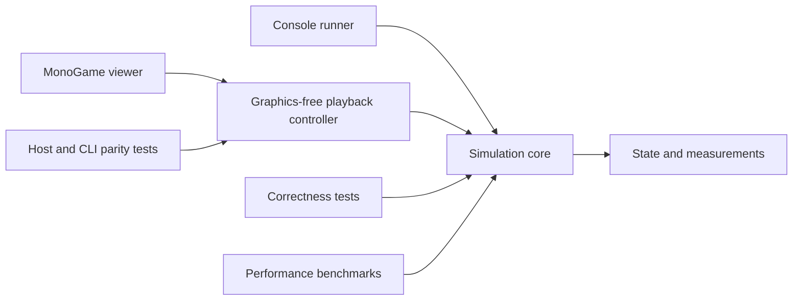

# Particle Life 2 architecture and migration plan

Particle Life 2 will modernize the original two-dimensional Particle Life simulation around an engine-independent C# core. The first release should make its behaviour reproducible, its equations explicit, and its performance measurable while retaining the attraction matrices and emergent patterns that motivated the project.

This is the implementation plan as of 4 November 2026. M1–M4 provide validated experiments, a tested simulation, headless CLI, interactive MonoGame viewer and exact uniform-grid acceleration. M4.1 adds measured packed CPU traversal, explicit workers and reusable exact diagnostics. The live experiment editor adds boundary reconfiguration, structural editing and shared scientific replay without changing those numerical conventions. M5 release work remains on hold.

## Scope and priorities

The immediate scope is the existing 2D simulation: correct its numerical and neighbour-search problems, separate simulation from presentation, preserve the main Particle Life presets, and provide a usable MonoGame viewer and a runner without graphics. Performance and readable, documented code are requirements throughout this work.

The original repositories remain historical references. The v0.2 prototype supplies research ideas rather than production infrastructure. Unity integration, 3D, gameplay, a general long-range solver, and new published active-matter models are later projects. The initial core will have specific 2D types and equations; a dimension-generic framework is unnecessary at this stage.

Development should favour a small number of clear responsibilities. Add an abstraction when it separates meaningful concerns or supports an actual alternative. Avoid a particle subclass for each species, a factory for every class, or a runtime plugin system before a concrete need exists.

## Architecture and dependency direction

The simulation core must build, run and be tested without loading a graphics framework. Hosts call into it and read completed state. The core has no dependency on a window, input device, texture, engine clock, camera or renderer.



Within the core, responsibilities are separated by namespace and ownership before introducing additional assemblies:

| Responsibility | Owns | Does not own |
| --- | --- | --- |
| State | Particle identity, positions, velocities, species and simulation time | Display colours, textures or force equations |
| Models | Interaction rules, parameters, boundaries, driving and dissipation | Rendering or neighbour-search implementation |
| Numerics | Neighbour discovery, force evaluation, integration and work buffers | Experiment selection or scientific interpretation |
| Experiments | Initial conditions, seeds, parameter sets, measurements and run metadata | Interactive UI or graphics resources |

The layout is:

```text
src/
  ParticleLife.Core/
    State/
    Models/
    Numerics/
    Experiments/
  ParticleLife.Cli/
  ParticleLife.Viewer/              # Graphics-free playback and presentation mapping
  ParticleLife.MonoGame/            # Window, input and rendering
tests/
  ParticleLife.Core.Tests/
  ParticleLife.Viewer.Tests/
  ParticleLife.MonoGame.Compatibility/
benchmarks/
  ParticleLife.Benchmarks/
examples/
  experiments/
```

The verified baseline is .NET 10 LTS, SDK 10.0.302 pinned in `global.json`, and MonoGame DesktopGL 3.8.6 pinned in the viewer and compatibility project. Native viewer startup has been verified on Windows; Linux CI builds the viewer and runs tests without a display, so it does not verify Linux native graphics startup. Microsoft's [support policy](https://dotnet.microsoft.com/en-us/platform/support/policy/dotnet-core) identifies .NET 10 as an LTS release, and the [MonoGame package](https://www.nuget.org/packages/MonoGame.Framework.DesktopGL/3.8.6) supports .NET 8 and later. Future Unity runtime compatibility and acceleration will be assessed separately; engine-independent source does not imply that every .NET assembly can be used unchanged in Unity.

`ParticleLife.Viewer` references only the core. It owns fixed-step playback policy, editor undo/redo, explicit generation, presets, safe storage and the isotropic coordinate transform. The core owns versioned scientific sessions and their shared replay engine; the CLI and viewer use that same implementation. `ParticleLife.MonoGame` owns window events, reusable widgets, graphics resources and display formatting. Widgets submit complete candidate changes to the graphics-free editor and never mutate particle arrays. This boundary lets display-free tests exercise the same controller used by the native application while keeping presentation and engine dependencies out of the core.

The native interface uses a compact inspector with Model, World and View pages, explicit dropdown choices and a separate Help panel. Its material hierarchy follows [Apple's material guidance](https://developer.apple.com/design/human-interface-guidelines/materials): restrained translucent surfaces for floating controls and stronger tint for text-heavy panels. This is a portable MonoGame treatment, not an AppKit Liquid Glass implementation. A reusable downsampled scene target softens the backdrop under panels and dialogs; numerical state and the unobscured particle view remain unchanged. The bundled OFL-licensed IBM Plex Sans atlas supplies proportional antialiased type without requiring installed fonts or a runtime content pipeline. Font asset authoring is documented beside the assets and is separate from application builds.

### Particle state and ownership

Keep separate contiguous arrays for positions, velocities and species identifiers. A particle is an identity and a set of state values, rather than an independently updating object. A species identifier selects model parameters; the viewer maps that identifier to a palette.

The first numerical implementation uses double precision for coordinates, velocities and force accumulation, with a small, documented two-component value type. This gives one straightforward reference path. Single precision, SIMD or another representation can be evaluated later against measured cost and numerical error. Do not build a generic float/double framework in the first version.

The simulation owns its arrays and preallocated working buffers. Observers receive read-only views valid until the next step, reset or successful reconfiguration. Persistent snapshots are explicit copies made outside the stepping loop. The viewer and solver run sequentially; reading a buffer concurrently while it is being written is outside the contract. A rejected edit, or a value-identical edit, does not invalidate the last completed observation.

The first model uses unit mass. Introduce typed storage for mass, charge, orientation or other properties when a model requires it. Avoid both a universal particle containing every conceivable property and string-keyed property lookups in the numerical loop.

### Models and numerical methods

A model states what the particles represent, the equations being evaluated, parameter meanings, units or reduced units, boundaries and dissipative or driven behaviour. A numerical method determines how those equations are evaluated and advanced in time. Switching from a direct search to a grid should preserve the model within a documented numerical tolerance.

Interactions are broader than radial forces. The first implementation needs radial pair interactions, a wall interaction and damping. Later models may require vector forces, orientation dynamics or stochastic terms. Add those as explicit capabilities with compatible integrators when needed; do not disguise them as a radial coefficient or implement unused extension mechanisms now.

Model terms may be composed when their quantities and assumptions agree. Force contributions add to a force buffer. Damping has an explicit integration rule. Potential energy, acceleration and force remain distinct in names and documentation. Validate configuration once when constructing or changing an experiment, and apply interactive changes only between completed steps.

Use substitution points for the direct and grid neighbour searches and for a numerical method that has a real alternative. Keep equations in small named functions. Choose the model or solver at the step or batch boundary where possible, avoiding layers of virtual calls, boxing and delegate allocation in the innermost pair loop. Exact public signatures should follow the first working slice rather than a speculative framework.

## Initial Particle Life model

The first model preserves the original short-range repulsion and species-dependent attraction. It is an explicit phenomenological model of interacting particles; it is not presented as validated electromagnetism or molecular dynamics.

Let `r` be pair separation, `R` the interaction cutoff, `q = r / R`, `beta` the repulsive-core fraction, and `a = A[species_i, species_j]` the directed interaction coefficient. Use the original coefficient curve:

```text
g(q, a) = q / beta - 1                                      for 0 < q < beta
          a * (1 - abs(2*q - 1 - beta) / (1 - beta))          for beta <= q < 1
          0                                                 for q >= 1

F_ij = F0 * g(q, a) * (position_j - position_i) / r
```

Positive coefficients in the outer region attract particle `i` towards `j`; negative coefficients repel it. The short-range repulsion is independent of species. Set `beta = 0.3` initially, require `0 < beta < 1`, and validate matrix entries in `[-1, 1]`. For this model the coefficient is already bounded, so it needs no additional global clamp.

The matrix is directed. Do not assume `A[i,j] = A[j,i]`, and do not replace two directed evaluations with an equal-and-opposite force shortcut. Reciprocal matrices are useful controlled cases, but arbitrary matrices need not conserve particle momentum. Damping also makes the baseline dissipative. A scientific connection to an active environment requires an explicit interpretation beyond selecting an arbitrary matrix.

Use reduced units, with a reference length, time and unit particle mass stated in the model's XML remarks. Initial defaults map from the original configuration as follows:

| Parameter | Initial value or mapping |
| --- | --- |
| World | Square `[0, 1] x [0, 1]`, independent of display resolution |
| Population and species | 500 particles and seven species as the initial preset, with configurable counts |
| Interaction cutoff `R` | `0.1` |
| Pair-force scale `F0` | `R * old ForceFactor`, initially `0.1 * 10 = 1` |
| Damping half-life | `0.025` simulation-time units |
| Timestep | `1 / 144` simulation-time units as the migration reference, independent of rendering frequency |
| Soft-wall layer width | `0.05` |
| Soft-wall strength | `old BoundaryRepulsionForce / reference timestep`, initially `0.01 * 144 = 1.44` for unit mass |

The wall mapping preserves the old velocity kick at its original reference timestep while making the new wall term a force integrated with `dt`. The resulting preset will still differ from the old program because order-dependent updates and duplicate neighbours are being corrected. Keep a record of those deliberate changes rather than requiring identical long-term trajectories.

The initial soft wall uses the existing linear inward response within its boundary layer, added to the force buffer. It is a confining interaction, not an impenetrable wall. The spatial index must handle finite positions outside the nominal world; it must not drop escaped particles. Reflecting and periodic boundaries can be introduced as separate documented choices later. Periodic support would require consistent wrapping, pair displacement and neighbour lookup together.

For each coordinate `x`, extent `L`, layer width `w` and strength `S`, the implemented wall force is `S * (1 - x/w)` below `w`, `-S * (1 - (L-x)/w)` when `L-x < w`, and zero elsewhere. It continues linearly off-world. Valid widths satisfy `0 < w <= min(width,height)/2`, keeping opposing layers separate. World dimensions, timestep and cutoff are finite and positive; the squared cutoff must also be finite and positive. Force scales are finite and nonnegative; zero disables the corresponding term. A null damping half-life disables damping; otherwise it must be finite and positive. Extreme state magnitudes that overflow intermediate arithmetic fail explicitly without publishing a partial step.

For exactly coincident particles, the initial radial model returns zero pair contribution because no direction is defined, and records an overlap count. Keep both particles. This is an explicit degenerate-case policy, not a physical collision resolution. Non-finite state or invalid parameters should produce a clear diagnostic, not silent deletion, force saturation or random separation.

### A consistent numerical step

1. Read the current state. Direct search enumerates all ordered pairs; grid search builds its index from these same completed positions.
2. Clear a reusable force buffer and evaluate all pair and wall forces from that same state.
3. Advance every particle into output buffers using the documented integration rule.
4. Swap completed buffers, advance simulation time, and expose the result.
5. Sample requested diagnostics at their configured cadence.

The first integrator retains a simple damped semi-implicit Euler form:

```text
damping = 2 ^ (-dt / halfLife)
velocity_next = damping * velocity + dt * totalForce / mass
position_next = position + dt * velocity_next
```

This is a first-order stepping scheme for the stated damped model. Compute the damping factor once per step or parameter change. A later model requiring a different integrator will define its own valid stages; the architecture must allow additional force evaluations from intermediate states. No force evaluation should accidentally observe a partly completed integration stage.

## Migration of the existing code

Use the original code and equations as references, bringing across small verified parts. The v0.2 octree and Morton implementation are outside this migration.

| Existing area | Migration decision |
| --- | --- |
| `ParticlesContainer` | Retain the array-based idea; establish state ownership, stable identities and read-only observation. |
| `ParticlePhysics` and `PhysicsEngine` | Replace the in-place loop and forwarding wrapper with explicit force and integration stages. |
| `IForceEquation` and `ForceCalculator` | Retain understandable equation functions; make coefficient, force and energy semantics explicit and remove the global clamp. |
| `FixedSizeGrid` | Keep uniform spatial partitioning as the first optimized strategy, but replace the duplicate-bucket query logic. |
| `MatrixProvider` | Retain random, chain and snake matrices with explicit seeding and serialized values. |
| `SimulationConfig` and `SimulationMode` | Split numerical/model configuration, experiment setup and presentation assets. Compute derived quantities rather than storing conflicting copies. |
| Factories and mode managers | Replace string-driven construction chains with a small typed composition point in each host. Add factories only where construction later becomes substantial. |
| `ParticleManager` | Separate initialization from rendering. |
| `ParticleCollisions` | Treat the current operation as an interaction-range test. Physical contact handling is a separate model feature. |
| `SimulationEngine` | Retain a MonoGame host for input and drawing, adapting it to completed core state. |

The first working slice includes the three Particle Life presets: random, chains and snakes. Handle the other modes explicitly during the 2D migration rather than silently treating their names as physical validation:

| Legacy mode | Planned treatment |
| --- | --- |
| SineWave | Candidate experimental radial kernel with a documented curve and parameters. |
| Predators | Candidate logarithmic interaction; its label does not establish a predator-prey model. |
| Coulomb and Magnetic | Review as truncated inverse-distance interaction experiments. Physically named replacements require their own equations and tests. |
| Elastic | Document the intended penalty force and any deliberate saturation before restoring it. |
| VanDerWaals and LennardJonesPotential | Defer physical claims until force-versus-potential and exponent errors are resolved. A corrected physical model is a separately versioned model. |

Restoring a legacy visual effect with explicit experimental naming and model-local saturation is different from replacing it with a physical force law. Record which choice is made. Full parity with every exploratory mode is not required for the first reliable 2D release; each omission must have a recorded disposition.

### Interactive playback and experiment changes

The native host shows a pixel-art startup splash for 2.5 active wall seconds after its first draw, with early dismissal by a key or left click. It consumes startup input and does not advance the experiment during the splash or its dismissal frame. The subsequent playback frame receives only its own elapsed time, so startup cannot create catch-up work. Focus loss retains the normal pause policy. The splash and platform icons are bundled presentation assets; the core and graphics-free hosts have no branding dependency.

The MonoGame host uses a variable presentation loop and a monotonic `Stopwatch` clock. It passes elapsed wall seconds to the graphics-free controller, scaled by an explicit playback speed. The default requests one reduced simulation-time unit per wall second. Integration uses the active numerical timestep, independent of rendering and playback speed. The default cap is eight completed steps per frame, editable separately. Remaining whole-step playback time is discarded and displayed; only the fractional remainder is retained. This bounds catch-up work without changing `dt`, but cannot bound the runtime of one dense quadratic step or measurement.

Window events submit commands at the beginning of `Update`, between completed steps. Pause/resume, numerical timestep changes and playback-speed changes clear pending playback time. Single-step pauses and completes exactly once. Reset and replacement clear backlog and dropped-time accounting. The host suppresses advancement in reset/load and scheduling-change command frames, so time spent in those actions cannot produce an unintended catch-up burst. Focus loss pauses playback and requires explicit resume. Text fields and widgets capture their input before simulation shortcuts. A numerical failure leaves the last completed state visible and pauses playback with an error.

The operation boundaries are explicit:

| Operation | Retained values | Replaced values |
| --- | --- | --- |
| Live model, matrix, timestep or execution edit | Exact particle identities, positions, velocities, accumulated time and completed-step count | Validated settings for subsequent steps; affected derived data and stale measurements |
| World Apply | Absolute positions and velocities, including finite off-world particles | Nominal soft-wall rectangle and coupled wall width |
| Population Apply | Deterministically selected surviving identities and their current state | Explicit removals, remapped species and actual generated additions |
| Generation recipe edit | All current particles and the clock | Seed, placement and initial-velocity recipe for a later explicit generation action |
| Matrix template | All current particles and the clock | Directed Random, Chains or Snakes coefficients |
| Resample | Identities, assignments, active model, matrix and clock | Actual newly generated positions and velocities, recorded as a structural event |
| Reset experiment | Defined baseline and its exact saved provenance | Baseline state/configuration at time and step zero; fresh replay and undo histories |
| New experiment / load | Previous valid experiment if validation or replacement fails | New baseline, actual initial state, cleared incompatible history; loads are paused |

Live edits never overwrite the reset baseline. Scalar changes validate the complete candidate, retain particle buffers and reuse the force evaluator and persistent workers when backend and worker count are unchanged. Cutoff edits invalidate grid geometry; damping changes update its derived factor. Only execution changes replace the evaluator and release the old workers after their completed barrier. Structural edits prepare actual state before publication. Invalid candidates leave state, clock, configuration, worker ownership and histories intact. Timestep changes add new increments to accumulated time; time is never reconstructed as `step * dt`.

Undo history and scientific replay are separate. One continuous slider gesture is one undo action, but every value actually applied at a completed boundary remains in the replay log. Parameter undo applies the prior value at the current boundary and does not rewind intervening dynamics. New edits after undo discard the redo branch. Structural undo retains the concrete payload needed to restore removed identities and assignments. Explicitly starting or loading an experiment establishes the new baseline; reset starts a fresh scientific timeline rather than retaining the abandoned trajectory.

Population edits first map a removed species by `oldSpecies % newSpeciesCount`, retain the first requested number of particles of each mapped species in storage order, and append shortfalls in species order. Survivors retain exact identities and motion. New identities increase past the timeline's high-water mark, including removed identities and loaded historical payloads. Matrix resizing retains the top-left block; new entries are zero. An even total distribution gives its remainder to the lowest species indices. Population undo preserves current motion for identities on both sides, revives removed identities with their saved removal-boundary motion, and removes added identities. Explicit resampling undo instead restores saved coordinates/velocities at the current clock. Neither operation rewinds time. A fresh baseline may start a fresh identity range.

The in-app file browser distinguishes a reusable preset, a rebased current-state experiment, the original baseline experiment, and a complete edited session. Presets contain a generation recipe and presentation/playback choices; applying compatible settings is separate from generating a new population. Current-state experiments preserve every actual particle value and record source time/step in origin metadata while starting the exported experiment at zero. Sessions retain the exact baseline, ordered applied events and terminal completed-step boundary. Existing files are protected by exclusive creation. Serialization and file I/O are outside numerical stepping, and saving does not mutate state or clocks. Detailed workflows are in the [editor guide](live-experiment-editor.md).

Rendering obtains `Observe()` only after stepping, reads its spans immediately, and retains no view across a step, reset or edit. The host runs input, simulation and drawing sequentially without a snapshot copy each frame. A single world-to-screen scale preserves geometry in the space beside the collapsible/scrollable editor; display size, palette and UI scale do not change physical lengths or trajectories. Rendering may skip pixels outside the viewport but never removes finite off-world particles. The selected pair's graph calls the implemented radial coefficient and shows `F0 * g(r/R,a)` in reduced force units, with positive values attracting the receiver. It is a force graph, not potential energy or evidence of a molecular model. Textures, font atlas, sprite batch and clipping state are reused and disposed with the host.

Viewer diagnostics default to every 144 completed steps, independently of rendered frames, with their own sampled time and step displayed. Zero disables sampling. Connectivity radius is a separate diagnostic setting; it can explicitly follow the force cutoff or use its own positive reduced length. Sampling rebuilds its own spatial index from completed state, reuses scratch storage, and remains outside the core step. Worst-case work is quadratic; each sample allocates its small immutable result. Edits affecting the measured configuration, reset, replacement and diagnostic-setting changes clear stale measurements. Optional measurement failure is reported separately and does not change trajectories. The CLI uses the same sampler and records failures independently of successful numerical steps.

## Performance design and measurement

Performance is part of the data and execution design from the beginning. Keep a readable serial reference path, establish its measurements, and use it to validate optimizations.

### Initial execution design

- Store state and working data contiguously. Reuse force, output-state and index buffers.
- Target zero managed allocations per core step after warm-up at an established capacity. Setup, resizing, exporting snapshots and optional reports are measured separately.
- Keep file I/O, formatting, logging and rendering outside the numerical loop.
- Reject out-of-range pairs using squared distance, then compute a square root once for an accepted radial interaction. Do not approximate the equation merely to make it faster.
- Start with a direct directed-pair implementation for small reference cases, then add an exact uniform-grid search.
- Give grid cells full integer-coordinate identity. Hash collisions must not merge distinct cells or emit duplicate neighbours. Reusable cell-head and particle-link storage is a reasonable first implementation; a custom low-level hash table is not a prerequisite.
- Enumerate each candidate once without a shared mutable query-result buffer. Handle empty cells, cluster occupancy, negative coordinates and off-world particles.
- Preserve particle identity when an index reorders references; explicitly map identities if storage is later reordered for locality.

Grid construction and storage should scale with particles and occupied cells. Exact local interaction work also depends on the number of candidate pairs. A cluster in which nearly every particle interacts can still require quadratic work. Benchmark density and interaction radius as well as particle count.

Parallel work assigns disjoint output ranges while all workers read the same input state and index. Do not apply action-reaction symmetry to nonreciprocal matrices. SIMD, reduced precision, unsafe code, GPU execution and approximation each require a measured benefit and a numerical-error check before adoption.

### Accepted M4 exact grid and backend selection

`Simulation` selects one of two serial `IForceEvaluator` implementations. The reference retains its independent nested receiver/source loops in storage order. Both evaluators share the reviewed pair mathematics, including subnormal-distance handling; the mathematical tests remain independent of search parity. The grid changes candidate discovery and accumulation order, never the directed matrix, radial curve, soft wall, damping or integrator.

The grid uses the smallest power-of-two cell width `h >= R` and the nine cells surrounding each receiver. Binary scaling followed by signed floor avoids rounded division at cell faces. Keys retain both full `Int64` coordinates; dictionary hash collisions cannot merge cells. A reusable link per particle represents all occupancy without truncation or a query-result buffer. Reverse insertion keeps each individual cell in ascending source order. Every distinct source occurs at most once per receiver. Coincident pairs retain the same unordered overlap count.

If any scaled coordinate is non-finite or has magnitude at least `2^50`, the entire force evaluation uses direct enumeration. Negative values that scale to negative zero map to cell `-1`; physical coordinates remain untouched. This conservative bound avoids unsafe conversion and preserves supported finite states at extreme position/cutoff ratios. The decision is made again from each step's input, so fallback is reversible. A non-finite grid-order force sum also retries the entire direct evaluation: very large alternating forces may cancel in reference order while overflowing in cell order. If direct evaluation also fails, the failure propagates atomically. Finite sums can still differ by roundoff; later integration failures are not retried. XML comments beside the mapping and pair kernel are the authoritative algorithm documentation.

Arrays and dictionary slots reserve for the largest population seen, allowing a cluster to spread into one occupied cell per particle without allocating. Each evaluation clears and rebuilds the index, including after reset, population changes and experiment replacement. At stable population, expected cost is `O(N + candidates)` and retained storage is `O(maximum population)`. After shrink, clearing the dictionary still costs `O(retained capacity)`. Dense local interactions still require quadratic work. The capacity report includes an explicitly labelled estimate of array payload, separate from measured allocated bytes and process memory.

Completed state, pair counts and execution metadata publish together only after integration succeeds. Failed force, integration or time checks leave all published values intact. Scratch index telemetry can change on a rejected stage, so hosts report the copied last-successful-step metadata. Cumulative counters record successful direct-fallback steps since reset, distinguishing coordinate range from accumulation range; reporting just the latest step would hide earlier fallback.

Core constructors and generators retain a direct default for API compatibility. Newly generated CLI and viewer experiments explicitly choose grid search. Loaded files use their saved choice, with schema 1 always meaning direct. CLI `create`/`run` and viewer startup accept `--backend direct|grid`. An explicit viewer override also applies on reload; reset, resampling, matrix editing and preset replacement retain the effective backend. Saving records that effective configuration. CLI reports retain the source experiment configuration separately from the override and actual execution. No parallel execution, SIMD, reduced precision, unsafe code or approximate search is introduced in M4.

### M4.1 CPU traversal, workers and diagnostics

The grid now counts cell occupancy and scatters sources into contiguous ranges, then packs positions and species. The nine-cell traversal and ascending source order within each cell remain unchanged from M4. Receiver results map back to original storage, preserving stable identities and each receiver's summation order. `uniform-grid/1` continues to name the same saved search convention; runtime reports additionally identify `uniform-grid-packed/1`. The direct evaluator remains independent enumeration, and the accepted M4 source is reconstructed under ignored artifacts for comparisons rather than retained as duplicate production code.

Grid `workerCount` is explicitly 1–8, including the caller. One is serial; additional persistent workers claim batches of 32 whole receivers from one immutable prepared input. Workers own disjoint outputs, never reduce partial force sums or share directed contributions. Every worker finishes before integration, direct retry, exception propagation or publication. Simulations and controllers own their worker lifecycle and implement `IDisposable`; experiment replacement constructs a valid replacement before releasing the previous simulation. No backend or worker count is selected from timings.

Schema 2 adds optional `workerCount`, defaulting to one when absent; schema 1 remains direct and serial. Saved choices survive editing, presets and reset. `--workers` explicitly overrides the current backend's workers; a backend change without a worker override selects one. Direct requires one. Reports distinguish saved, requested and actual settings, the implementation version and cumulative fallback causes. Workers preserve the serial grid's arithmetic order, but direct/grid accumulation roundoff and long chaotic divergence remain distinct issues.

`Diagnostics.Sample` remains the direct reference. `DiagnosticSampler` separately validates linear speed measurements, counts exact duplicate positions, and finds inclusive geometric connected components with reusable union/find and spatial storage. Connections use the reference `double.Hypot(dx,dy) <= radius` predicate, never force accepted-pair counts. Its binary cell width is strictly greater than the radius, covering inclusive rounded-boundary cases that the force index's width policy would miss. Positive finite radii whose square underflows or overflows remain valid; unrepresentable widths or coordinates use exact direct connectivity. Duplicate counting precedes connectivity early exit, and all scratch is instance-owned.

The [M4.1 evidence](performance-m4-1.md) separates static density/population scaling, adjacent-double cutoff transitions, developed preset snapshots, subsequent evolving trajectories, worker counts, diagnostic latency, retained capacity and allocation boundaries. Buffered Verlet lists remain a later experiment; no SIMD, approximation, reduced precision, GPU, BVH or computational-geometry subsystem is introduced here.

### Benchmark protocol

Use [BenchmarkDotNet](https://benchmarkdotnet.org/articles/guides/good-practices.html) for isolated CPU benchmarks in Release mode without a debugger, and its [memory diagnoser](https://benchmarkdotnet.org/articles/configs/diagnosers.html) for allocation measurements. Use a separate timed runner for step-latency distributions and end-to-end interactive measurements. Keep the input workload reproducible; restore identical starting state outside the measured region when comparing a single step.

| Scenario | Purpose |
| --- | --- |
| 500, 2,000 and 10,000 uniformly distributed particles in a fixed domain | Expose the cost of increasing density. These are benchmark inputs, not promised interactive capacities. |
| The same counts at fixed density, expanding the domain with population | Separate population scaling from increased neighbour count. |
| Dense cluster and narrow band | Exercise the workloads central to emergent behaviour. |
| Boundary, off-world and coincident cases | Confirm correctness under difficult geometry; overlap is a robustness case. |

Record commit, runtime/SDK, build configuration, OS, CPU, thread count, population, domain, cutoff, species count, seed and actual initial state. Report index-build time, interaction time, integration time, complete-step p50/p95 latency, allocations, candidate and accepted pair counts, and numerical error against the reference. Measure rendering and diagnostics overhead separately; FPS alone does not describe solver performance.

The first numerical milestone records a reference machine and baseline. The optimization milestone sets achievable particle-count and step-time budgets using those results. For an optimization to be accepted, correctness and allocation gates must pass, and repeated comparable runs must demonstrate the claimed benefit. Treat timing on shared CI runners as advisory until a stable benchmark environment exists; do not block changes on an arbitrary noisy percentage.

## Validation and reproducible experiments

Tests should establish the mathematical and state contracts rather than mirror private implementation details:

| Contract | Verification |
| --- | --- |
| Pair curve and sign | Values at repulsive, attractive, transition and cutoff distances; documented zero-separation behaviour. |
| State consistency | A two-particle reciprocal case and reordered inputs produce equivalent next states within an explicit tolerance after matching particle identities. |
| Neighbour correctness | Compare accepted neighbour sets and force sums with direct evaluation for uniform, clustered, boundary, negative-coordinate and coincident cases. |
| Timestep handling | Check pair and wall increments, analytic damping with no other force, and convergence over a fixed simulated duration as `dt` decreases. |
| Model-specific invariants | Test momentum only for reciprocal interactions with driving, damping and external forces disabled. Do not require conservation from the driven baseline. |
| Numerical safety | Reject non-finite state and invalid configuration; verify that no particles disappear or acquire NaNs in supported cases. |
| Repeatability | Reset from a saved initial state and compare repeated runs under the same runtime and solver configuration. |
| Host scheduling and geometry | Drive the viewer's actual controller with irregular frames, pause/resume, single-step, reset and replacement; verify bounded catch-up and isotropic mapping. |
| CLI/viewer parity | Save fixtures and generated/edited experiments, invoke the actual CLI, and compare against the viewer controller after 120 steps by stable identity. |
| Live editing and replay | Preserve completed state/clock during scalar edits; reject invalid candidates atomically; test structural membership, gesture undo and actual saved payloads. Replay saved editor sessions with variable timesteps through the real CLI and shared viewer engine, including terminal edits and continuation. |
| Performance | Verify steady-capacity allocations and maintain representative benchmark results. |

Use combined absolute and relative tolerances with a documented scale and reason. Short deterministic cases establish implementation correctness; long emergent runs should also be compared through statistics over multiple seeds. Chaotic trajectories need not remain point-for-point identical after a numerical-method change.

An experiment stores a schema/model version, parameters, matrix, initial positions/velocities/species, seed, generator identity, timestep, boundaries and solver settings. A checkpoint additionally stores current time/state and any evolving RNG state when randomness enters the dynamics. Record runtime and numerical backend. A seed alone does not promise identical results across runtimes or future parallel implementations.

JSON experiments persist every initial value, stable identity and directed matrix entry in row-major receiver/source order. Schema 1 remains readable with exactly its original `particle-life/1` model and `direct-damped-semi-implicit-euler/1` solver meaning. Saving writes schema 2, which separates the unchanged model, `damped-semi-implicit-euler/1` integration and `direct/1` or `uniform-grid/1` neighbour search. Both schemas require `reduced-l0-t0-m0` units and `soft-wall` boundaries. Unknown/duplicate fields, missing required values, unsupported versions and invalid state fail on load. No legacy fixture is silently reinterpreted as grid execution.

Schema 2 permits optional origin metadata for a current-state rebase; the initial-state clock remains zero. Legacy files retain their original meaning. The graphics-free session format has its own `particle-life-session` identifier and schema version 1. It stores the complete initial experiment, an ordered list of typed configuration changes with optional exact structural state and generator provenance, and the terminal step. List order is authoritative for equal boundaries. Every boundary-zero event applies before the first numerical step; reached events apply after that completed step and before the next; terminal events apply even when no next step exists. Empty populations and zero-step sessions are valid. Parsing checks ordering, fields, versions, species and values without running dynamics; replay additionally checks structural payload time against the actual accumulated timestep sum.

`SessionReplayRunner` is the single incremental event engine for both hosts. The viewer replays into an isolated temporary simulation in bounded batches, keeping the active experiment paused and intact until successful terminal publication. Cancellation and failure dispose temporary workers. On success, the original session baseline and scientific event history remain available for continued edits; old undo history is cleared. Reset then starts a fresh run from that loaded baseline. CLI `replay` can continue additional steps after the terminal boundary. Overrides are explicit, applied to every configuration, and retained separately in reports alongside the unmodified source session and actual requested/executed step segments. No replay uses wall-clock frame timestamps or seeds to reconstruct particles.

Presets and viewer companions are separately versioned graphics-free data types. Presets contain exact configuration, per-species generation counts, placement/velocity recipe and presentation/playback settings. Scientific experiment/session files remain usable by the CLI without companions. A `.viewer.json` companion is bound to the scientific file's serialized contents by SHA-256; a mismatch or malformed companion rejects viewer loading before active replacement. Strict JSON contracts reject duplicate, unknown, missing required, non-finite and unsupported values. No format serializes arbitrary object types or executable command payloads. Safe viewer saves serialize first, exclusively create `.save.lock` reservations for every destination, flush same-directory temporary files, then publish by non-overwriting rename. Reservations cover publication and rollback across cooperating processes; Unix rename alone does not arbitrate competing writers. Failures clean up only files created by that operation. An interrupted process can leave a reservation, which must only be removed after confirming no writer is active. This protocol does not make two files transactional for readers or coordinate unrelated applications that ignore reservations. The graphics-free native compatibility check races independent processes through both single-file and paired saves on Windows and Linux CI.

Experiments start at time and step zero; CLI schema-2 run reports embed the decoded source experiment and final state, preserve the original input-file hash, and distinguish saved search, explicit override, requested execution and actual last-step execution. They include successful direct-fallback counts and reasons; a zero-step report has no last execution. Reports are not checkpoint inputs. There is no RNG in the dynamics. Random generation uses explicitly seeded `System.Random` with generator version and runtime recorded; actual saved values take precedence over provenance.

Diagnostics are sampled only when requested by the host. CLI cadence is expressed in completed steps; zero disables sampling. Cluster statistics count connected components of the undirected graph with separation at most the configured distance, including singletons. Exact overlaps are unordered pairs; force candidates and accepted interactions are directed pairs. Sampling is O(N squared), can allocate, and is measured separately from stepping. No potential energy is reported for arbitrary directed matrices.

Initial measurements include particle count, finite-state/overlap checks, speed and simple cluster statistics with an explicit distance criterion and sampling cadence. More expensive measurements are optional and run outside the core timing benchmark. Saving snapshots and selecting measurements must not change the equations being evaluated.

## Migration milestones

Each milestone should end in small verified commits and a useful result. The sequence stops at a reliable, documented 2D application.

| Milestone | Work | Exit criteria |
| --- | --- | --- |
| M0 Planning and local Git | Establish this plan, repository conventions and source references. | Plan and contributor guidance committed; generated review files excluded. |
| M1 Build and experiment foundation | Pin SDK/packages; create core, tests and CLI; define units, state ownership, preset format and XML documentation build. Confirm MonoGame package compatibility with a minimal build. | Core builds without graphics dependencies; saved initial-state fixture loads and validates; documentation warnings are checked; basic build/test CI is added when a remote exists. |
| M2 Correct serial simulation | Implement the stated Particle Life curve, direct pair evaluation, wall term, damping and consistent integration. Add random, chain and snake presets and a CLI runner. | Pair, update-order, timestep, overlap and finite-state checks pass; reference measurements and reproducible run metadata are recorded. |
| M3 Interactive 2D application | Adapt MonoGame rendering and controls; add pause, single-step, explicit reset/resample and diagnostic display. | A saved experiment gives the same step results through CLI and viewer; geometry is not display-dependent; simulation and rendering clocks are separated. |
| M4 Spatial acceleration | Add the exact uniform grid, reusable buffers and profiling. Evaluate parallel work only if profiling justifies it. | Neighbour and force parity pass; no steady-capacity step allocation; benchmark comparisons include density/cluster cases and recorded capacity targets. |
| M5 Documented 2D release | Review the remaining legacy modes, provide examples, generate API docs, finish CI checks and record limitations. | Every legacy mode has a disposition; public API docs build; contributors can reproduce tests, examples and benchmark protocol from a clean checkout. |

M1–M4 and the live experiment editor are implemented. Build, automated validation and native window checks are described in [CONTRIBUTING.md](../CONTRIBUTING.md). The [historical reference baseline](performance-baseline.md) retains M2/M3 provenance; the [M4 comparison](performance-m4.md) records controlled direct/grid measurements, capacity targets and limitations. The [editor comparison](performance-live-editor.md) separates solver timing, actual edits and native presentation costs. M5 remains on hold for a subsequent release review. No Unity adapter, octree, FMM, 3D state or gameplay system is needed to complete these milestones.

## Repository workflow and documentation

[CONTRIBUTING.md](../CONTRIBUTING.md) defines code style, XML documentation, performance evidence and commit practice. API and algorithm documentation live beside their C# implementations and generate the reference documentation. This Markdown plan records architecture and migration decisions; it does not become a manually maintained class catalogue.

Use short-lived branches for cohesive implementation work and make frequent commits at verified boundaries. Introduce correctness fixes separately from optimizations where practical, so changes in results can be explained. Keep `main` usable, inspect staged changes before committing, and include source, relevant tests and XML updates together.

CI is configured for locked restore, formatting, Release builds including the viewer, numerical and host tests with actual CLI parity, display-free viewer help, the managed MonoGame compatibility check, XML compiler-failure probes and CLI smoke checks. Native window checks are a separate manual gate. At M5, add rendered-documentation checks and broader core OS coverage. Tools and packages remain pinned; benchmark artifacts stay separate from normal source output. Generated XML is available locally, while full API-site publishing is deferred.

The GitHub remote is [M3G4W4TT5/ParticleLife2](https://github.com/M3G4W4TT5/ParticleLife2), created as a private repository. The local repository uses `origin` for this remote. Project licensing remains to be selected before a public release. Old repositories do not need to be rewritten or repurposed.

## Source references and review evidence

The migration references are [ParticleLife at a0a0699](https://github.com/M3G4W4TT5/ParticleLife/tree/a0a0699e859ea0a9e91c823b71cd6ec1376f6f23) and [ParticleLife v0.2 Prototype at 7973ec6](https://github.com/M3G4W4TT5/ParticleLife_v0.2_Prototype/tree/7973ec61b7dcdf3d85909307a155e23ae1c57004). The baseline force definition comes from [ParticleLife.cs](https://github.com/M3G4W4TT5/ParticleLife/blob/a0a0699e859ea0a9e91c823b71cd6ec1376f6f23/Simulation/Physics/Force/Equations/ParticleLife.cs), [ForceCalculator.cs](https://github.com/M3G4W4TT5/ParticleLife/blob/a0a0699e859ea0a9e91c823b71cd6ec1376f6f23/Simulation/Physics/Force/ForceCalculator.cs) and [CreateStandardConfig.cs](https://github.com/M3G4W4TT5/ParticleLife/blob/a0a0699e859ea0a9e91c823b71cd6ec1376f6f23/Simulation/Configuration/CreateStandardConfig.cs).

Targeted review checks found duplicate neighbour IDs, a grid-query buffer overflow, particle-order-dependent integration and a wall velocity increment unchanged when `dt` was halved. For example, the same neighbour was returned twice within a `0.1` query radius, and the wall increment remained `0.005` for both `dt = 1/144` and `dt = 1/288`. These were headless checks on copied source using .NET 10 with `System.Numerics.Vector2` substituted for MonoGame's vector type. They are not a full application build or a performance baseline. The local `review/` directory preserves the working evidence but is excluded from the new repository; M2 recreates the relevant cases as maintained tests.

The v0.2 review found an unfinished updater, high-bit loss in the Morton encoder and rejection of excess particles in finest-level octree cells. None of those implementations is a dependency of this plan.

Later research candidates include [nonreciprocal effective interactions](https://journals.aps.org/prx/abstract/10.1103/PhysRevX.5.011035) and [asymmetric clustering in active mixtures](https://journals.aps.org/prl/abstract/10.1103/PhysRevLett.133.258303). They can inform separately specified models after the existing 2D foundation is established.
