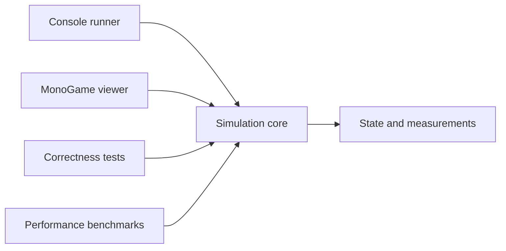

# Particle Life 2 architecture and migration plan

Particle Life 2 will modernize the original two-dimensional Particle Life simulation around an engine-independent C# core. The first release should make its behaviour reproducible, its equations explicit, and its performance measurable while retaining the attraction matrices and emergent patterns that motivated the project.

This is the implementation plan as of 4 November 2026. Its project layout, numerical defaults and milestone gates are proposed decisions for the first implementation. The repository currently contains planning and development conventions; application implementation has not started.

## Scope and priorities

The immediate scope is the existing 2D simulation: correct its numerical and neighbour-search problems, separate simulation from presentation, preserve the main Particle Life presets, and provide a usable MonoGame viewer and a runner without graphics. Performance and readable, documented code are requirements throughout this work.

The original repositories remain historical references. The v0.2 prototype supplies research ideas rather than production infrastructure. Unity integration, 3D, gameplay, a general long-range solver, and new published active-matter models are later projects. The initial core will have specific 2D types and equations; a dimension-generic framework is unnecessary at this stage.

Development should favour a small number of clear responsibilities. Add an abstraction when it separates meaningful concerns or supports an actual alternative. Avoid a particle subclass for each species, a factory for every class, or a runtime plugin system before a concrete need exists.

## Architecture and dependency direction

The simulation core must build, run and be tested without loading a graphics framework. Hosts call into it and read completed state. The core has no dependency on a window, input device, texture, engine clock, camera or renderer.



Within the core, responsibilities are separated by namespace and ownership before introducing additional assemblies:

| Responsibility | Owns | Does not own |
| --- | --- | --- |
| State | Particle identity, positions, velocities, species and simulation time | Display colours, textures or force equations |
| Models | Interaction rules, parameters, boundaries, driving and dissipation | Rendering or neighbour-search implementation |
| Numerics | Neighbour discovery, force evaluation, integration and work buffers | Experiment selection or scientific interpretation |
| Experiments | Initial conditions, seeds, parameter sets, measurements and run metadata | Interactive UI or graphics resources |

The proposed layout is:

```text
src/
  ParticleLife.Core/
    State/
    Models/
    Numerics/
    Experiments/
  ParticleLife.Cli/
  ParticleLife.MonoGame/
tests/
  ParticleLife.Core.Tests/
benchmarks/
  ParticleLife.Benchmarks/
examples/
  experiments/
```

These directories are created as their milestones begin. Use .NET 10 LTS as the proposed first runtime baseline, then pin a supported SDK and compatible MonoGame package versions during the initial build check. Microsoft's [support policy](https://dotnet.microsoft.com/en-us/platform/support/policy/dotnet-core) identifies .NET 10 as an LTS release. Future Unity runtime compatibility and acceleration will be assessed separately; engine-independent source does not imply that every .NET assembly can be used unchanged in Unity.

### Particle state and ownership

Keep separate contiguous arrays for positions, velocities and species identifiers. A particle is an identity and a set of state values, rather than an independently updating object. A species identifier selects model parameters; the viewer maps that identifier to a palette.

The proposed first numerical implementation uses double precision for coordinates, velocities and force accumulation, with a small, documented two-component value type. This gives one straightforward reference path. Single precision, SIMD or another representation can be evaluated later against measured cost and numerical error. Do not build a generic float/double framework in the first version.

The simulation owns its arrays and preallocated working buffers. Observers receive read-only views valid until the next step or reset. Persistent snapshots are explicit copies made outside the stepping loop. The initial viewer and solver run sequentially; reading a buffer concurrently while it is being written is outside the contract.

The first model uses unit mass. Introduce typed storage for mass, charge, orientation or other properties when a model requires it. Avoid both a universal particle containing every conceivable property and string-keyed property lookups in the numerical loop.

### Models and numerical methods

A model states what the particles represent, the equations being evaluated, parameter meanings, units or reduced units, boundaries and dissipative or driven behaviour. A numerical method determines how those equations are evaluated and advanced in time. Switching from a direct search to a grid should preserve the model within a documented numerical tolerance.

Interactions are broader than radial forces. The first implementation needs radial pair interactions, a wall interaction and damping. Later models may require vector forces, orientation dynamics or stochastic terms. Add those as explicit capabilities with compatible integrators when needed; do not disguise them as a radial coefficient or implement unused extension mechanisms now.

Model terms may be composed when their quantities and assumptions agree. Force contributions add to a force buffer. Damping has an explicit integration rule. Potential energy, acceleration and force remain distinct in names and documentation. Validate configuration once when constructing or changing an experiment, and apply interactive changes only between completed steps.

Use substitution points for the direct and grid neighbour searches and for a numerical method that has a real alternative. Keep equations in small named functions. Choose the model or solver at the step or batch boundary where possible, avoiding layers of virtual calls, boxing and delegate allocation in the innermost pair loop. Exact public signatures should follow the first working slice rather than a speculative framework.

## Initial Particle Life model

The first model preserves the original short-range repulsion and species-dependent attraction. It is an explicit phenomenological model of interacting particles; it is not presented as validated electromagnetism or molecular dynamics.

Let `r` be pair separation, `R` the interaction cutoff, `q = r / R`, `beta` the repulsive-core fraction, and `a = A[species_i, species_j]` the directed interaction coefficient. Use the original coefficient curve:

```text
g(q, a) = q / beta - 1                                      for 0 < q < beta
          a * (1 - abs(2*q - 1 - beta) / (1 - beta))          for beta <= q < 1
          0                                                 for q >= 1

F_ij = F0 * g(q, a) * (position_j - position_i) / r
```

Positive coefficients in the outer region attract particle `i` towards `j`; negative coefficients repel it. The short-range repulsion is independent of species. Set `beta = 0.3` initially, require `0 < beta < 1`, and validate matrix entries in `[-1, 1]`. For this model the coefficient is already bounded, so it needs no additional global clamp.

The matrix is directed. Do not assume `A[i,j] = A[j,i]`, and do not replace two directed evaluations with an equal-and-opposite force shortcut. Reciprocal matrices are useful controlled cases, but arbitrary matrices need not conserve particle momentum. Damping also makes the baseline dissipative. A scientific connection to an active environment requires an explicit interpretation beyond selecting an arbitrary matrix.

Use reduced units, with a reference length, time and unit particle mass stated in the model's XML remarks. Initial defaults map from the original configuration as follows:

| Parameter | Proposed initial value or mapping |
| --- | --- |
| World | Square `[0, 1] x [0, 1]`, independent of display resolution |
| Population and species | 500 particles and seven species as the initial preset, with configurable counts |
| Interaction cutoff `R` | `0.1` |
| Pair-force scale `F0` | `R * old ForceFactor`, initially `0.1 * 10 = 1` |
| Damping half-life | `0.025` simulation-time units |
| Timestep | `1 / 144` simulation-time units as the migration reference, independent of rendering frequency |
| Soft-wall layer width | `0.05` |
| Soft-wall strength | `old BoundaryRepulsionForce / reference timestep`, initially `0.01 * 144 = 1.44` for unit mass |

The wall mapping preserves the old velocity kick at its original reference timestep while making the new wall term a force integrated with `dt`. The resulting preset will still differ from the old program because order-dependent updates and duplicate neighbours are being corrected. Keep a record of those deliberate changes rather than requiring identical long-term trajectories.

The initial soft wall uses the existing linear inward response within its boundary layer, added to the force buffer. It is a confining interaction, not an impenetrable wall. The spatial index must handle finite positions outside the nominal world; it must not drop escaped particles. Reflecting and periodic boundaries can be introduced as separate documented choices later. Periodic support would require consistent wrapping, pair displacement and neighbour lookup together.

For exactly coincident particles, the initial radial model returns zero pair contribution because no direction is defined, and records an overlap count. Keep both particles. This is an explicit degenerate-case policy, not a physical collision resolution. Non-finite state or invalid parameters should produce a clear diagnostic, not silent deletion, force saturation or random separation.

### A consistent numerical step

1. Read the current state and build the neighbour index from those positions.
2. Clear a reusable force buffer and evaluate all pair and wall forces from that same state.
3. Advance every particle into output buffers using the documented integration rule.
4. Swap completed buffers, advance simulation time, and expose the result.
5. Sample requested diagnostics at their configured cadence.

The proposed first integrator retains a simple damped semi-implicit Euler form:

```text
damping = 2 ^ (-dt / halfLife)
velocity_next = damping * velocity + dt * totalForce / mass
position_next = position + dt * velocity_next
```

This is a first-order stepping scheme for the stated damped model. Compute the damping factor once per step or parameter change. A later model requiring a different integrator will define its own valid stages; the architecture must allow additional force evaluations from intermediate states. No force evaluation should accidentally observe a partly completed integration stage.

## Migration of the existing code

Use the original code and equations as references, bringing across small verified parts. The v0.2 octree and Morton implementation are outside this migration.

| Existing area | Migration decision |
| --- | --- |
| `ParticlesContainer` | Retain the array-based idea; establish state ownership, stable identities and read-only observation. |
| `ParticlePhysics` and `PhysicsEngine` | Replace the in-place loop and forwarding wrapper with explicit force and integration stages. |
| `IForceEquation` and `ForceCalculator` | Retain understandable equation functions; make coefficient, force and energy semantics explicit and remove the global clamp. |
| `FixedSizeGrid` | Keep uniform spatial partitioning as the first optimized strategy, but replace the duplicate-bucket query logic. |
| `MatrixProvider` | Retain random, chain and snake matrices with explicit seeding and serialized values. |
| `SimulationConfig` and `SimulationMode` | Split numerical/model configuration, experiment setup and presentation assets. Compute derived quantities rather than storing conflicting copies. |
| Factories and mode managers | Replace string-driven construction chains with a small typed composition point in each host. Add factories only where construction later becomes substantial. |
| `ParticleManager` | Separate initialization from rendering. |
| `ParticleCollisions` | Treat the current operation as an interaction-range test. Physical contact handling is a separate model feature. |
| `SimulationEngine` | Retain a MonoGame host for input and drawing, adapting it to completed core state. |

The first working slice includes the three Particle Life presets: random, chains and snakes. Handle the other modes explicitly during the 2D migration rather than silently treating their names as physical validation:

| Legacy mode | Planned treatment |
| --- | --- |
| SineWave | Candidate experimental radial kernel with a documented curve and parameters. |
| Predators | Candidate logarithmic interaction; its label does not establish a predator-prey model. |
| Coulomb and Magnetic | Review as truncated inverse-distance interaction experiments. Physically named replacements require their own equations and tests. |
| Elastic | Document the intended penalty force and any deliberate saturation before restoring it. |
| VanDerWaals and LennardJonesPotential | Defer physical claims until force-versus-potential and exponent errors are resolved. A corrected physical model is a separately versioned model. |

Restoring a legacy visual effect with explicit experimental naming and model-local saturation is different from replacing it with a physical force law. Record which choice is made. Full parity with every exploratory mode is not required for the first reliable 2D release; each omission must have a recorded disposition.

The viewer retains mode selection and reset, adds pause and single-step, and displays model name, simulation time, timestep and numerical diagnostics. Reset restores the same experiment; resampling initial state and generating a new random matrix are separate actions. Map world coordinates to pixels using an isotropic scale so the window aspect ratio does not distort the simulated geometry.

## Performance design and measurement

Performance is part of the data and execution design from the beginning. Keep a readable serial reference path, establish its measurements, and use it to validate optimizations.

### Initial execution design

- Store state and working data contiguously. Reuse force, output-state and index buffers.
- Target zero managed allocations per core step after warm-up at an established capacity. Setup, resizing, exporting snapshots and optional reports are measured separately.
- Keep file I/O, formatting, logging and rendering outside the numerical loop.
- Reject out-of-range pairs using squared distance, then compute a square root once for an accepted radial interaction. Do not approximate the equation merely to make it faster.
- Start with a direct directed-pair implementation for small reference cases, then add an exact uniform-grid search.
- Give grid cells full integer-coordinate identity. Hash collisions must not merge distinct cells or emit duplicate neighbours. Reusable cell-head and particle-link storage is a reasonable first implementation; a custom low-level hash table is not a prerequisite.
- Enumerate each candidate once without a shared mutable query-result buffer. Handle empty cells, cluster occupancy, negative coordinates and off-world particles.
- Preserve particle identity when an index reorders references; explicitly map identities if storage is later reordered for locality.

Grid construction and storage should scale with particles and occupied cells. Exact local interaction work also depends on the number of candidate pairs. A cluster in which nearly every particle interacts can still require quadratic work. Benchmark density and interaction radius as well as particle count.

Parallel work can later assign disjoint output ranges to workers while all workers read the same input state and index. Introduce it only after the serial implementation is correct and measured. Do not apply action-reaction symmetry to nonreciprocal matrices. SIMD, reduced precision, unsafe code, GPU execution and approximation each require a measured benefit and a numerical-error check before adoption.

### Benchmark protocol

Use [BenchmarkDotNet](https://benchmarkdotnet.org/articles/guides/good-practices.html) for isolated CPU benchmarks in Release mode without a debugger, and its [memory diagnoser](https://benchmarkdotnet.org/articles/configs/diagnosers.html) for allocation measurements. Use a separate timed runner for step-latency distributions and end-to-end interactive measurements. Keep the input workload reproducible; restore identical starting state outside the measured region when comparing a single step.

| Scenario | Purpose |
| --- | --- |
| 500, 2,000 and 10,000 uniformly distributed particles in a fixed domain | Expose the cost of increasing density. These are benchmark inputs, not promised interactive capacities. |
| The same counts at fixed density, expanding the domain with population | Separate population scaling from increased neighbour count. |
| Dense cluster and narrow band | Exercise the workloads central to emergent behaviour. |
| Boundary, off-world and coincident cases | Confirm correctness under difficult geometry; overlap is a robustness case. |

Record commit, runtime/SDK, build configuration, OS, CPU, thread count, population, domain, cutoff, species count, seed and actual initial state. Report index-build time, interaction time, integration time, complete-step p50/p95 latency, allocations, candidate and accepted pair counts, and numerical error against the reference. Measure rendering and diagnostics overhead separately; FPS alone does not describe solver performance.

The first numerical milestone records a reference machine and baseline. The optimization milestone sets achievable particle-count and step-time budgets using those results. For an optimization to be accepted, correctness and allocation gates must pass, and repeated comparable runs must demonstrate the claimed benefit. Treat timing on shared CI runners as advisory until a stable benchmark environment exists; do not block changes on an arbitrary noisy percentage.

## Validation and reproducible experiments

Tests should establish the mathematical and state contracts rather than mirror private implementation details:

| Contract | Verification |
| --- | --- |
| Pair curve and sign | Values at repulsive, attractive, transition and cutoff distances; documented zero-separation behaviour. |
| State consistency | A two-particle reciprocal case and reordered inputs produce equivalent next states within an explicit tolerance after matching particle identities. |
| Neighbour correctness | Compare accepted neighbour sets and force sums with direct evaluation for uniform, clustered, boundary, negative-coordinate and coincident cases. |
| Timestep handling | Check pair and wall increments, analytic damping with no other force, and convergence over a fixed simulated duration as `dt` decreases. |
| Model-specific invariants | Test momentum only for reciprocal interactions with driving, damping and external forces disabled. Do not require conservation from the driven baseline. |
| Numerical safety | Reject non-finite state and invalid configuration; verify that no particles disappear or acquire NaNs in supported cases. |
| Repeatability | Reset from a saved initial state and compare repeated runs under the same runtime and solver configuration. |
| Performance | Verify steady-capacity allocations and maintain representative benchmark results. |

Use combined absolute and relative tolerances with a documented scale and reason. Short deterministic cases establish implementation correctness; long emergent runs should also be compared through statistics over multiple seeds. Chaotic trajectories need not remain point-for-point identical after a numerical-method change.

An experiment stores a schema/model version, parameters, matrix, initial positions/velocities/species, seed, generator identity, timestep, boundaries and solver settings. A checkpoint additionally stores current time/state and any evolving RNG state when randomness enters the dynamics. Record runtime and numerical backend. A seed alone does not promise identical results across runtimes or future parallel implementations.

Initial measurements include particle count, finite-state/overlap checks, speed and simple cluster statistics with an explicit distance criterion and sampling cadence. More expensive measurements are optional and run outside the core timing benchmark. Saving snapshots and selecting measurements must not change the equations being evaluated.

## Migration milestones

Each milestone should end in small verified commits and a useful result. The sequence stops at a reliable, documented 2D application.

| Milestone | Work | Exit criteria |
| --- | --- | --- |
| M0 Planning and local Git | Establish this plan, repository conventions and source references. | Plan and contributor guidance committed; generated review files excluded. |
| M1 Build and experiment foundation | Pin SDK/packages; create core, tests and CLI; define units, state ownership, preset format and XML documentation build. Confirm MonoGame package compatibility with a minimal build. | Core builds without graphics dependencies; saved initial-state fixture loads and validates; documentation warnings are checked; basic build/test CI is added when a remote exists. |
| M2 Correct serial simulation | Implement the stated Particle Life curve, direct pair evaluation, wall term, damping and consistent integration. Add random, chain and snake presets and a CLI runner. | Pair, update-order, timestep, overlap and finite-state checks pass; reference measurements and reproducible run metadata are recorded. |
| M3 Interactive 2D application | Adapt MonoGame rendering and controls; add pause, single-step, explicit reset/resample and diagnostic display. | A saved experiment gives the same step results through CLI and viewer; geometry is not display-dependent; simulation and rendering clocks are separated. |
| M4 Spatial acceleration | Add the exact uniform grid, reusable buffers and profiling. Evaluate parallel work only if profiling justifies it. | Neighbour and force parity pass; no steady-capacity step allocation; benchmark comparisons include density/cluster cases and recorded capacity targets. |
| M5 Documented 2D release | Review the remaining legacy modes, provide examples, generate API docs, finish CI checks and record limitations. | Every legacy mode has a disposition; public API docs build; contributors can reproduce tests, examples and benchmark protocol from a clean checkout. |

The first implementation task should be M1, followed by the smallest complete serial simulation in M2. No Unity adapter, octree, FMM, 3D state or gameplay system is needed to complete these milestones.

## Repository workflow and documentation

[CONTRIBUTING.md](../CONTRIBUTING.md) defines code style, XML documentation, performance evidence and commit practice. API and algorithm documentation live beside their C# implementations and generate the reference documentation. This Markdown plan records architecture and migration decisions; it does not become a manually maintained class catalogue.

Use short-lived branches for cohesive implementation work and make frequent commits at verified boundaries. Introduce correctness fixes separately from optimizations where practical, so changes in results can be explained. Keep `main` usable, inspect staged changes before committing, and include source, relevant tests and XML updates together.

At M1, add formatting, Release build and focused tests to CI; at M5, include generated-documentation checks and appropriate core OS coverage. Pin tools and packages, and record benchmark artifacts separately from normal build output. CI and documentation generation are planned here, not installed in this planning-only repository.

The local repository has no remote initially. Select the GitHub repository name, visibility and project license when setting up remote publication, then push the existing history. Old repositories do not need to be rewritten or repurposed.

## Source references and review evidence

The migration references are [ParticleLife at a0a0699](https://github.com/M3G4W4TT5/ParticleLife/tree/a0a0699e859ea0a9e91c823b71cd6ec1376f6f23) and [ParticleLife v0.2 Prototype at 7973ec6](https://github.com/M3G4W4TT5/ParticleLife_v0.2_Prototype/tree/7973ec61b7dcdf3d85909307a155e23ae1c57004). The baseline force definition comes from [ParticleLife.cs](https://github.com/M3G4W4TT5/ParticleLife/blob/a0a0699e859ea0a9e91c823b71cd6ec1376f6f23/Simulation/Physics/Force/Equations/ParticleLife.cs), [ForceCalculator.cs](https://github.com/M3G4W4TT5/ParticleLife/blob/a0a0699e859ea0a9e91c823b71cd6ec1376f6f23/Simulation/Physics/Force/ForceCalculator.cs) and [CreateStandardConfig.cs](https://github.com/M3G4W4TT5/ParticleLife/blob/a0a0699e859ea0a9e91c823b71cd6ec1376f6f23/Simulation/Configuration/CreateStandardConfig.cs).

Targeted review checks found duplicate neighbour IDs, a grid-query buffer overflow, particle-order-dependent integration and a wall velocity increment unchanged when `dt` was halved. For example, the same neighbour was returned twice within a `0.1` query radius, and the wall increment remained `0.005` for both `dt = 1/144` and `dt = 1/288`. These were headless checks on copied source using .NET 10 with `System.Numerics.Vector2` substituted for MonoGame's vector type. They are not a full application build or a performance baseline. The local `review/` directory preserves the working evidence but is excluded from the new repository; M2 recreates the relevant cases as maintained tests.

The v0.2 review found an unfinished updater, high-bit loss in the Morton encoder and rejection of excess particles in finest-level octree cells. None of those implementations is a dependency of this plan.

Later research candidates include [nonreciprocal effective interactions](https://journals.aps.org/prx/abstract/10.1103/PhysRevX.5.011035) and [asymmetric clustering in active mixtures](https://journals.aps.org/prl/abstract/10.1103/PhysRevLett.133.258303). They can inform separately specified models after the existing 2D foundation is established.
