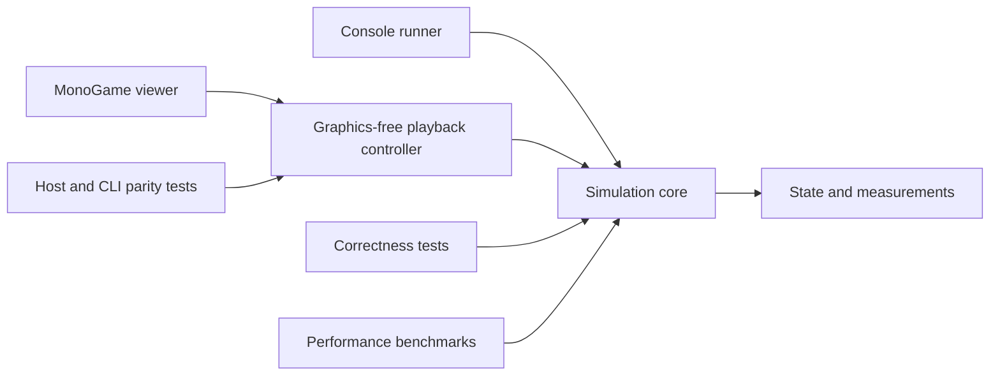

# Particle Life 2 architecture and migration plan

Particle Life 2 is a creative sandbox for making and exploring emergent particle behaviour. The priorities are interesting patterns, many more particles, responsive controls and an enjoyable way to discover, save and revisit results. Reproducibility supports that experience; scientific validation is not the product's purpose.

Direction updated **5 November 2026**. M1–M4, M4.1 and the live experiment editor provide the CPU foundation. P1–P7 features are implemented and integrated. Capacity measurements, package smoke checks and the full contributor gates are complete; consolidated native acceptance is in progress. P8 remains deferred. The historical M5 release backlog is incorporated into P7.

## Scope and priorities

The immediate implementation scope remains 2D. Include the performance and UX improvements identified in the comparison with Tom Mohr's Particle Life App and SandboxScience, including periodic boundaries and directed per-species-pair interaction ranges. Keep CPU simulation as a supported user choice alongside GPU execution, with a CPU-only headless runner that does not require a GPU runtime.

3D is included as P8, after the expanded 2D application is usable. Do not build 3D state, a 3D renderer or a dimension-generic framework during the earlier phases. Unity integration, gameplay systems, long-range physical solvers and research-model validation are outside this roadmap. The original repositories and v0.2 prototype remain references rather than production dependencies.

Development should favour a small number of clear responsibilities. Add an abstraction when it separates meaningful concerns or supports an actual alternative. Avoid a particle subclass for each species, a factory for every class, or a runtime plugin system before a concrete need exists.

## Product and engineering commitments

- **Creative exploration first.** Single precision, approximate arithmetic, experimental force curves and visual effects are welcome. Explain what a control does and show useful results; a physical interpretation, conservation study or publication-grade numerical analysis is not required for each feature.
- **Keep ordinary correctness.** Complete a step from consistent inputs, retain particle membership unless an explicit edit changes it, avoid buffer races and invalid state, and protect saved work. Optimizations must not silently drop neighbours or change a saved rule. A deliberate approximation is a named, saved choice with a practical supported range.
- **Keep CPU and GPU choices distinct from search and precision.** CPU/GPU selects execution hardware; direct/grid selects neighbour evaluation; precision describes arithmetic. Preserve the current double-precision CPU reference. Offer useful defaults without requiring users to understand every internal option, and show the resolved device and settings.
- **Keep reproducibility useful and honest.** Save actual state, rules, generation provenance, applied edits and backend/precision/version metadata. Exact state restoration is distinct from replaying a trajectory. Test replay within supported configurations; do not promise identical long CPU/GPU trajectories or bitwise GPU replay across devices. Include checkpoints and a terminal capture for sessions where backend ordering prevents reliable trajectory reconstruction.
- **Keep clocks separate.** Numerical timestep and playback speed remain separate. Slow work can reduce achieved simulation speed or presentation quality; it must not secretly change timestep, cutoff, density, precision or population. Quality adaptation may reduce glow, trails or rendering frequency without changing the simulation.
- **Measure proportionately.** Use small reference cases and representative evolving scenes, including dense structures. Report the workload and observed differences alongside a speedup. Extreme numeric support can remain specific to the existing CPU backend; new paths may reject unsupported ranges clearly. Preserve existing tests and file meanings until a deliberate, versioned change replaces them.

## Phased roadmap

Each phase ends with a usable result and focused verification. The order is driven by dependencies rather than dates. P1 informs both the CPU improvements and GPU integration; P4 establishes the richer 2D model before P5 finalizes its GPU kernels. P3 and P6 UI work can proceed alongside model/backend work once their required command and capture interfaces exist. Saving and replay support accompany every state-changing feature, rather than waiting for the library phase.

| Phase | Result | Main dependency |
| --- | --- | --- |
| P1 Performance baseline and execution design | Measured targets and a feasible GPU/rendering integration choice | Existing CPU app |
| P2 Responsive CPU simulation and bulk rendering | A smoother app with improved CPU capacity | P1 |
| P3 Exploration controls and direct manipulation | Faster editing, navigation and experimentation | P2 completed-state command boundary |
| P4 Boundaries and per-pair ranges | Richer 2D rules, usable and saved on CPU | P2; extends P3 controls |
| P5 Selectable GPU simulation | GPU-resident 2D simulation with CPU choice retained | P1 integration decision, P2, P4 |
| P6 Discovery library and visual tools | Easy saving, replay, sharing and observation | P3; integrates P4/P5 captures |
| P7 Large-population tuning and 2D release | Measured capacity, polished workflows and distribution | P2–P6 |
| P8 3D exploration, later | An optional 3D mode with CPU and GPU support | Usable expanded 2D release; deferred |

### Implementation status and decisions

| Phase | Current evidence and outstanding acceptance |
| --- | --- |
| P1 | Saved twenty geometry/population fixtures through 250k plus a 1M fixed-density stretch input; bounded CPU screens and timeout protection verified. Existing MonoGame context demonstrated compute/render buffer sharing, exact capture/restore and CPU-only startup. See [performance evidence](performance-p1.md) and [GPU boundary](gpu-integration.md). |
| P2 | Background CPU ownership, bounded edit queues and reusable completed render leases are implemented. Native drawing uses bulk GL points with a MonoGame quad fallback. Explicit CPU workers through 64, larger population controls and density-preserving resize are implemented; measured alternatives and rejected SIMD are recorded in [P2 evidence](performance-p2.md). Automated ownership/render/worker checks pass; native responsiveness and graphics timing remain pending the consolidated review. |
| P3 | Six control pages, expandable advanced execution, camera navigation/size modes, matrix selection/bulk/clipboard, population bars, independent generators/palettes and grouped direct brush edits are implemented. Focused behavior, replay, persistence and managed native-widget checks pass. Bulk-renderer integration retains camera and brush geometry; native acceptance remains pending the consolidated review. |
| P4 | Soft/open/reflecting/periodic CPU worlds, directed radii, versioned legacy-compatible formats, selected/bulk controls, physical force/radius diagrams and mapped brush/density undo are implemented. Reference, replay, format, editor, worker/allocation and graphics-free checks pass. Matched CPU evidence retains coarse receiver-row rectangles and rejects quarter cells; see [model/editor behavior](world-boundaries-and-ranges.md) and [range performance](performance-p4-ranges.md). Native cases remain pending the consolidated review. |
| P5 | Resident float32 OpenGL simulation, shared-buffer rendering, ordered CPU/GPU transfer, explicit captures/checkpoints, failure retention and graphics-free capture restore/re-simulation are implemented. Focused ownership/persistence/CLI checks and eighteen production hardware fixtures pass on the recorded RTX 5080 Laptop GPU. P6 visual/library integration is complete. See [GPU evidence](gpu-integration.md#p5-production-implementation-and-verification); sustained capacity and native interaction acceptance are separate P7 gates. |
| P6 | Searchable discovery thumbnails, metadata, selective presets, validated file sharing, compressed recording storage, explicit captured-session restore, asynchronous file preparation, visual effects, bounded CPU/GPU observations, region tracking and PNG/GIF capture are implemented. Persistence/editor, graphics-free controls, GPU observation/presentation and independent GIF decoding checks pass. A measured 50k-particle brush session verifies storage and exact action/capture restoration; see [discovery and recording](discovery-and-recording.md). Native acceptance remains pending the consolidated review. |
| P7 | Sixteen matched CPU/GPU capacity screens, accepted GPU dispatch tuning, explicit visual quality presets, keyboard/guide improvements, examples and private Windows packaging are implemented. The [capacity report](performance-p7.md) separates solver, resident drawing, observations and explicit storage costs. All sixteen CPU/GPU capacity cases, actual package smoke checks and the full contributor gates are complete. The consolidated native review is in progress, with partial observations and unresolved findings recorded in the [visual checklist](visual-review-checklist.md). |

The full [contributor gates](../CONTRIBUTING.md#build-and-verification) passed at P7 phase commit `073ba0f`: locked restore, full formatting, Release build with zero warnings, 629 tests with no failures or skips, viewer help, graphics-free compatibility, XML compiler probes and all 66 CLI checks. Integrated follow-up fixes cover CPU particle visibility, floating-point trail decay, cumulative GIF timing and clearer failure feedback. Production-path rendering checks and native CPU/GPU media decoding verify the affected behavior; exact tested sources and remaining cases are in the [visual checklist](visual-review-checklist.md). Timing controls (`45f8ed3`, integrated at `cc273e5`) pass the native build and full graphics-free compatibility checks. [Ubuntu CI](https://github.com/M3G4W4TT5/ParticleLife2/actions/runs/42121579114/job/127575008804) at `e0cc033` passed locked restore, formatting, Release build with zero warnings/errors, all 631 tests with no failures, viewer help, full graphics-free compatibility, XML probes and all 66 CLI commands. User physical editing/capture confirmations, exact saved CPU-session replay and independently decoded capture lifecycle files extend native coverage. These checks and verified package smokes remain separate from the unfinished native gate, including remaining dense/live-edit V14 cases. Focus/visible timing-feedback fix `1dedd74` (integrated at `6536e981`) passes affected format/build/graphics-free compatibility checks; Preview 07 packages that clean source with smoke and all 448 payload hash/size checks passing. Its focused native recheck passes.

[Exact-head CI](https://github.com/M3G4W4TT5/ParticleLife2/actions/runs/42197598519/job/127824638930) at `0741e41` passes all full gates, 631 tests and 66 CLI checks. Preview 07 running-request transfers, exact saved capture restoration, selective generator/radius artifacts and GPU 100k idle windows extend native coverage as recorded in the checklist. Preview 08 CPU50k Luminous and GPU100k Economy/Luminous physical running-pan observations now have user confirmation and scoped numeric reports; GPU reports are rolling tails without observed new Reset lines. Four earlier GPU edits remain unclassified, so no quality-causation conclusion is drawn. Dense/live-edit and other explicit acceptance actions remain pending. Preview 07 exposed a same-clock CPU render-cache collision after owner replacement, with exact saved simulation state retained. Fix `867f4606` is integrated at `a45d038c`; affected automated/production pixel checks and the focused Preview 08 native transfer/load recheck pass. Preview 08 packaging from clean `a45d038c` passes smokes and all 448 manifest payload hashes/sizes. This closes that renderer finding; V12 and the whole review retain their remaining partial coverage. [Exact-head CI](https://github.com/M3G4W4TT5/ParticleLife2/actions/runs/42208597254) at `80b8006` passes all full gates, 632 tests and 66 CLI checks, including the renderer fix and documentation checkpoint. Preview 08 user-confirmed GPU brush/keyboard behavior and exact terminal capture/pattern comparison extend coverage without claiming measured minimum dimensions or deterministic GPU replay.

The first GPU platform is Windows with the existing MonoGame DesktopGL context and optional OpenGL 4.3+ compute support; the demonstrated device is an RTX 5080 Laptop GPU with OpenGL 4.6. CPU-only headless operation remains independent. Production drawing must split common rendering capabilities from optional compute capabilities and retain a CPU renderer fallback. Native resources belong to the current graphics thread; shaders consume completed device storage with explicit barriers, and full readback occurs only for deliberate captures/transfers. This decision avoids a host migration while keeping device ownership explicit.

P1 uses a 60 FPS presentation target, separately reported fixed-step achieved speed, and explicit deadlines for expensive scenes. Its two-warmup/five-sample CPU runs are feasibility screens, not steady-state optimization evidence. Full native input/layout acceptance remains deferred to the [consolidated review](visual-review-checklist.md); the early GPU check was necessary to establish interoperability. Its saved framebuffer and machine pixel checks passed. The early direct CUA attempt encountered an app-access timeout; that historical limitation does not describe current native access. Current observations and remaining coverage are in the consolidated checklist.

### P1 Performance baseline and execution design

- Extend the saved workload set with 10,000, 50,000, 100,000 and 250,000 particles, then explore one million where feasible. These are measurement points, not promised interactive limits. Cover fixed density, fixed area, bands, dense clusters and evolved patterns; record cutoff/range distributions and world size.
- Measure step p50/p95, achieved simulation time per wall second, rendering FPS/cost, input responsiveness, CPU allocations and memory. Add GPU timing, device memory and transfer costs when available. Begin with a 60 FPS presentation target and report whether the chosen fixed timestep/playback speed is sustained; measure dense cases separately and stop impractical stress runs at a stated budget.
- Make a small GPU feasibility prototype: select a compute API/device adapter and demonstrate compute-to-render buffer sharing, synchronization, capture and CPU-only startup. Check the existing MonoGame integration before choosing any host change; do not assume a compute-only kernel can share its buffers with the current renderer. Keep this prototype bounded and separate from production code.
- Record the chosen integration boundary, supported first platform, measured baseline and phase budgets here or in a linked maintained performance report. Prefer the current Windows desktop target first; do not make broad GPU platform support a prerequisite.

Exit: comparable saved workloads, useful performance targets and a demonstrated route from GPU computation to display and capture. No numerical behaviour changes merely to improve the baseline score.

### P2 Responsive CPU simulation and bulk rendering

- Move simulation work off the input/render loop. Apply queued edits at completed boundaries and publish completed render data through reusable buffers with explicit ownership. Bound command/snapshot backlog; coalesce previews or unapplied drag requests while recording every value actually applied. Keep pause, single-step, reset and cancellation predictable.
- Render particles through bulk buffers and point/instanced drawing, with camera transforms on the rendering side where useful. Preserve the CPU solver and avoid allocating a complete snapshot per numerical step. Measure submission, upload, overdraw and present separately.
- Make parallel CPU execution discoverable. Measure suitable worker counts and scheduling on representative workloads, consider counts beyond the current eight-worker cap, retain manual control and save the resolved count. A suggested/default count is not a universal fastest setting.
- Profile and compare SIMD, more suitable packed/component layouts, specialized ordinary-range arithmetic, optional single precision and approximate reciprocal/square-root arithmetic. Keep only worthwhile changes; retain the existing CPU reference and clear supported-range/fallback behaviour.
- Compare tighter cell widths/subdivisions and selective neighbour stencils against the current power-of-two grid, especially at cutoff transitions. Consider buffered neighbour lists only if rebuild/traversal measurements justify their maintenance cost. Preserve unbounded cell occupancy and directed interactions in exact modes.
- Show graphics FPS, simulation steps/s, achieved playback speed and useful density/interaction statistics separately. Provide sensible large-population controls and an explicit option to resize the world with population to preserve density, instead of relying on a 5,000-particle slider and hidden larger typed values.

Exit: representative large CPU workloads retain usable input, and accepted optimizations have matched-workload evidence. Saves, replay, failed-step handling and existing CPU-only operation still work. A busy worker never exposes partly updated state to rendering or editing.

### P3 Exploration controls and direct manipulation

- Organize controls around particles, interactions, world, playback, appearance and saved discoveries. Keep common controls close to the canvas and advanced execution options expandable. Retain exact entry, useful logarithmic sliders, contextual help, shortcuts, undo/redo and clear Reset/Resample/New meanings.
- Add pan, zoom, fit/reset and optional camera smoothing. Offer particle size in screen pixels or world-relative display units without changing interaction radii.
- Extend matrix editing with multi-cell/row/column selection, bulk set/scale/randomize/reset operations, linked reverse pairs and clipboard import/export. Retain receiver/source labels, validation, exact values and the force graph; make drag and keyboard actions discoverable.
- Add coloured population bars with counts/percentages, equalization and direct species adjustments. Keep surviving identities and motion during population changes.
- Separate position, velocity, species-assignment, matrix and palette generation. Include uniform/disk/ring/line/spiral/stripe/grid/cluster layouts, separated species groups, partial species reassignment and rotate/flip species operations. Each action states whether it changes current particles, future generation or a new experiment; preserve actual generated results in saves/replay.
- Add move, paint/add, erase, attract, repel and directional-force brushes, with size, shape, intensity and species selection. Record affected identities/structural payloads or boundary-indexed force-tool samples; replay uses applied simulation actions rather than wall-clock pointer movement. Group a gesture for undo without erasing its applied replay history.
- Add palette presets and species-header colour pickers. Keep appearance changes independent of motion and boundary geometry.

Exit: users can create, perturb and revise a pattern directly, then undo or replay the relevant edits. Editing remains usable while simulation is busy; changing palette or camera never changes the trajectory.

### P4 Boundaries and per-pair ranges

- Retain current soft walls and open space, and add periodic wrapping and reflecting boundaries as explicit world choices. Periodic mode wraps positions, uses minimum-image displacement and queries across seams consistently. Test seam/corner cases and deduplicate wrapped cell visits in small grids; particle size on screen must not set a physical wall margin.
- Add directed pair tables for interaction coefficient, core radius and outer cutoff, with a simple global mode and bulk editing. Existing files map to `coreRadius = beta * R` and `cutoff = R` for every pair, preserving their meaning. Define supported ranges and the zero-core policy; show the selected pair's implemented curve and radius diagram.
- Start the CPU grid with a conservative maximum active cutoff, then evaluate receiver-specific ranges/stencils if heterogeneous ranges waste substantial work. Keep a small direct reference for the new model. Start periodic support with the maximum cutoff no greater than half the shortest world extent, so each pair has one minimum-image interaction; reject unsupported settings clearly rather than accidentally counting repeated images.
- Version model/configuration/save formats as required. Preserve old soft-wall experiments unchanged. Specify what live world/boundary changes do to coordinates and record any wrapping or remapping as an explicit edit. Add selective randomization of rules, radii or both, and migrate presets and replay with these controls.

Exit: all boundary choices and directed ranges work on CPU, with focused reference/geometry checks, useful editor controls and reliable save/load/replay. The GPU model contract can now follow a working 2D implementation.

P4 retains maximum-cutoff cells and uses conservative row rectangles only for nonperiodic pair tables with different receiver-row maxima. The rectangle preserves accepted contribution order and unbounded occupancy; global, equal-row and periodic selection remain unchanged. The matched [evaluation](performance-p4-ranges.md) includes static/evolving, dense/sparse, mild heterogeneity, cutoff transitions and worker controls. Its quarter-cell alternative was rejected for sparse regressions. Reproduction commands and measured binary/input hashes are in that report; native visual acceptance is a separate pending gate.

### P5 Selectable GPU simulation

- Implement the full normal step on the GPU: count spatial bins, build offsets, scatter/sort particles, evaluate forces from stable input, integrate into completed output and render from device buffers. Use scalable scan/sorting methods appropriate to measured grid sizes; do not copy a particular prefix-sum implementation without profiling it.
- Make single precision the initial GPU candidate, with coefficient/radius storage that preserves their useful values, including exact zero. Compare short steps and representative evolving scenes against CPU within documented tolerances. Deterministic GPU reductions/sorts are optional work if their value justifies their cost.
- Preserve stable particle identities through sorting and structural edits. Support P4 boundaries/ranges and P3 editing through the same logical commands. Keep buffers resident during normal stepping; read full state on explicit capture, transfer or structural operations when required, and use device reductions/scheduled summaries for inexpensive diagnostics.
- Expose a clear **CPU / GPU** choice, device information and availability. Switch at a completed boundary with an explicit state transfer; retain identities, rules and clock, and record any precision conversion as part of the session. A failed switch retains the active valid backend. CPU operation, saves and the CLI must work without a usable GPU.
- Add reliable capture/checkpoint support before claiming GPU save or replay parity. Offer distinct actions to restore a recorded capture or re-simulate recorded actions. Restoring captured values is exact within their stored precision; re-simulation may diverge even on the same GPU when ordering is not repeatable. Periodic/terminal captures recover recorded boundaries, not the original trajectory between them. A CPU-only CLI can restore such a capture or explicitly re-simulate on CPU; it must not silently present that run as equivalent GPU replay.
- Handle allocation/device failures visibly. Pause and offer CPU continuation from the latest valid captured state when available; do not claim that uncaptured state survives device loss. Expensive CPU captures/diagnostics must not become hidden work on every GPU frame.

Exit: users can run the same supported 2D model on CPU or GPU, switch deliberately, save and resume it, and understand observed speed/replay differences. Publish matched workload results including rendering, transfers and diagnostics rather than a particle-count limit alone.

### P6 Discovery library and visual tools

- Add a searchable thumbnail library with names, descriptions, tags and recent/favourite views. Distinguish reusable presets, captured patterns, initial states and recorded sessions while keeping common Save/Load actions simple.
- Support selective preset components such as matrix, radii, palette and generation settings, with explicit species alignment/retention. Add validated clipboard/file import and export for sharing; sharing means creating an artifact, not automatically publishing it online.
- Keep existing save protection and legacy loading. For large populations and long brush sessions, measure history/capture size and introduce chunked or compressed state storage and checkpoint-backed history where useful. Show recording status and storage limits; never silently truncate a session represented as complete.
- Add trails, velocity-based colour/brightness, opacity, normal/additive blending and configurable glow. Include spatial-bin/population heatmaps and optional statistics as observation aids; expensive measurements remain optional and clearly show their sample time.
- Add selected-region/pattern tracking with camera follow and an indicator. Treat this as a visual tracking heuristic rather than organism detection. Add screenshots and short GIF/video capture, with capture cost/quality controls and no changes to numerical timestep.

Exit: a discovery can be found visually, restored, continued and shared with its intended rules/state. Visual effects and recording remain responsive on representative large scenes, and optional analysis does not dictate simulation speed.

### P7 Large-population tuning and 2D release

- Revisit the P1 population ladder on CPU and GPU after patterns have evolved. Report practical ranges for sparse worlds, heterogeneous ranges and dense structures, with hardware, precision, timestep, achieved simulation speed and presentation settings. Treat one million as a stretch measurement, not a requirement to cut corners on membership or saved rules.
- Tune device memory, transfer/capture scheduling, neighbour search, render overdraw and visual quality presets. Optional automatic backend/quality suggestions must remain overridable and visible; never silently substitute another model or reduce particle count.
- Finish keyboard/accessibility and small-window workflows, onboarding, errors, presets, portable packaging and supported-platform smoke checks. Review useful legacy visual kernels for clearly named experimental presets; scientific validation is not a prerequisite for restoring an intentional visual rule.
- Incorporate the old M5 examples, clean-checkout instructions, legacy-mode dispositions and release documentation. Keep XML comments useful; a generated API website is optional tooling rather than a gate on a usable sandbox. Publishing remains a separate release action.

Exit: a usable 2D release with selectable CPU/GPU simulation, dependable discoveries/replay, representative capacity evidence and clear platform limits. This is the foundation for the deferred 3D phase.

### P8 3D exploration, later

This phase is planned but deliberately deferred until the expanded 2D app is established. It does not authorize building 3D infrastructure during P1–P7.

- Extend state and rules to three spatial dimensions, preserving directed species interactions, pair ranges and appropriate open/soft/reflecting/periodic boundaries. Retain both CPU and GPU execution; begin with a simple 3D reference and a measured 3D spatial grid before considering octrees or other structures.
- Add orbit/pan/zoom and optional fly controls, depth cues, fit/recenter, clipping/slice inspection and deliberate brush placement on a selected plane or at a selected depth. Adapt tracking, population/matrix editing and generators to volumes.
- Compare billboard and instanced particle rendering with depth handling, transparency and overdraw budgets. Avoid committing to costly sphere meshes or a game-engine migration before measuring what the view needs.
- Version dimension explicitly in state, presets and sessions. Existing 2D files retain 2D meaning; any embedding of a 2D state into 3D is an explicit operation with new provenance. Reuse saving, library and editing concepts without assuming every implementation should be dimension-generic.
- Establish separate 3D performance targets using volume density, cutoff and evolved clusters. Retain exact captured states and practical replay metadata, with the same cross-backend limits as 2D.

Exit, when this phase is undertaken: an optional, usable 3D exploration mode with CPU/GPU choice and save/resume, while 2D remains a supported, efficient mode.

## Target execution and reproducibility boundary

The shared C# model/data contracts, CPU simulation, persistence and CPU CLI remain independent of graphics APIs. A GPU adapter owns kernels, device storage and synchronization; a compatible renderer may consume its completed buffers directly. Do not force a resident GPU implementation through the current CPU-span `IForceEvaluator` contract. Introduce only the execution/capture interfaces demonstrated necessary by P1/P2/P5.

One owner advances a simulation and applies commands at completed boundaries. Rendering receives a completed buffer lease or reusable snapshot, never a view into a buffer being overwritten. File captures are explicit owned states. Device changes, precision conversion, structural editing, async diagnostics and cancellation have defined publication points. Small edits should not require a full state download; operations that do require one may be visibly asynchronous.

Use versioned rules, actual values and stable identities as the common interchange. Keep friendly names and help in the UI; reserve algorithm versions, precision details and device metadata for advanced views and saved records. Preserve the existing deterministic CPU conventions where practical, but do not make matching them bit-for-bit a prerequisite for the fast backend. Replay plus checkpoints supports revisiting a discovery even when arithmetic changes its subsequent evolution.

The sections below document the implemented 2D CPU baseline and its migration history. Their model and file-format contracts remain relevant alongside the implemented P1–P7 extensions above. The native host now uses background CPU ownership and completed render leases, or the explicit GPU buffer boundary; the original sequential host is historical.

## Architecture and dependency direction

The simulation core must build, run and be tested without loading a graphics framework. Hosts call into it and read completed state. The core has no dependency on a window, input device, texture, engine clock, camera or renderer.



Within the core, responsibilities are separated by namespace and ownership before introducing additional assemblies:

| Responsibility | Owns | Does not own |
| --- | --- | --- |
| State | Particle identity, positions, velocities, species and simulation time | Display colours, textures or force equations |
| Models | Interaction rules, parameters, boundaries, driving and dissipation | Rendering or neighbour-search implementation |
| Numerics | Neighbour discovery, force evaluation, integration and work buffers | Experiment selection or scientific interpretation |
| Experiments | Initial conditions, seeds, parameter sets, measurements and run metadata | Interactive UI or graphics resources |

The layout is:

```text
src/
  ParticleLife.Core/
    State/
    Models/
    Numerics/
    Experiments/
  ParticleLife.Cli/
  ParticleLife.Viewer/              # Graphics-free playback and presentation mapping
  ParticleLife.MonoGame/            # Window, input and rendering
tests/
  ParticleLife.Core.Tests/
  ParticleLife.Viewer.Tests/
  ParticleLife.MonoGame.Compatibility/
benchmarks/
  ParticleLife.Benchmarks/
examples/
  experiments/
```

The verified baseline is .NET 10 LTS, SDK 10.0.302 pinned in `global.json`, and MonoGame DesktopGL 3.8.6 pinned in the viewer and compatibility project. Native viewer startup has been verified on Windows; Linux CI builds the viewer and runs tests without a display, so it does not verify Linux native graphics startup. Microsoft's [support policy](https://dotnet.microsoft.com/en-us/platform/support/policy/dotnet-core) identifies .NET 10 as an LTS release, and the [MonoGame package](https://www.nuget.org/packages/MonoGame.Framework.DesktopGL/3.8.6) supports .NET 8 and later. Future Unity runtime compatibility and acceleration will be assessed separately; engine-independent source does not imply that every .NET assembly can be used unchanged in Unity.

`ParticleLife.Viewer` references only the core. It owns fixed-step playback policy, editor undo/redo, explicit generation, presets, safe storage and the isotropic coordinate transform. The core owns versioned scientific sessions and their shared replay engine; the CLI and viewer use that same implementation. `ParticleLife.MonoGame` owns window events, reusable widgets, graphics resources and display formatting. Widgets submit complete candidate changes to the graphics-free editor and never mutate particle arrays. This boundary lets display-free tests exercise the same controller used by the native application while keeping presentation and engine dependencies out of the core.

The native interface uses a compact inspector with Particles, Interactions, World, Playback, Appearance and Discoveries pages, explicit dropdown choices and a separate Help panel. Its material hierarchy follows [Apple's material guidance](https://developer.apple.com/design/human-interface-guidelines/materials): restrained translucent surfaces for floating controls and stronger tint for text-heavy panels. This is a portable MonoGame treatment, not an AppKit Liquid Glass implementation. A reusable downsampled scene target softens the backdrop under panels and dialogs; numerical state and the unobscured particle view remain unchanged. The bundled OFL-licensed IBM Plex Sans atlas supplies proportional antialiased type without requiring installed fonts or a runtime content pipeline. Font asset authoring is documented beside the assets and is separate from application builds.

### Particle state and ownership

Keep separate contiguous arrays for positions, velocities and species identifiers. A particle is an identity and a set of state values, rather than an independently updating object. A species identifier selects model parameters; the viewer maps that identifier to a palette.

The current CPU implementation uses double precision for coordinates, velocities and force accumulation, with a small, documented two-component value type. This remains the reference path. P2 evaluates CPU arithmetic/layout alternatives and P5 adds the GPU representation; neither requires a generic float/double framework in advance.

The simulation owns its arrays and preallocated working buffers. Direct observers receive read-only views valid until the next step, reset or successful reconfiguration. Persistent snapshots are explicit copies made outside the stepping loop. The desktop CPU host uses a background numerical owner and reusable completed render-buffer leases; input and drawing never read partly updated numerical arrays. The GPU owner separately fences completed device buffers shared with its renderer. A rejected edit, or a value-identical edit, does not invalidate the last completed observation.

The first model uses unit mass. Introduce typed storage for mass, charge, orientation or other properties when a model requires it. Avoid both a universal particle containing every conceivable property and string-keyed property lookups in the numerical loop.

### Models and numerical methods

A model states what the particles represent, the equations being evaluated, parameter meanings, units or reduced units, boundaries and dissipative or driven behaviour. A numerical method determines how those equations are evaluated and advanced in time. Switching from a direct search to a grid should preserve the model within a documented numerical tolerance.

Interactions are broader than radial forces. The first implementation needs radial pair interactions, a wall interaction and damping. Later models may require vector forces, orientation dynamics or stochastic terms. Add those as explicit capabilities with compatible integrators when needed; do not disguise them as a radial coefficient or implement unused extension mechanisms now.

Model terms may be composed when their quantities and assumptions agree. Force contributions add to a force buffer. Damping has an explicit integration rule. Potential energy, acceleration and force remain distinct in names and documentation. Validate configuration once when constructing or changing an experiment, and apply interactive changes only between completed steps.

Use substitution points for the direct and grid neighbour searches and for a numerical method that has a real alternative. Keep equations in small named functions. Choose the model or solver at the step or batch boundary where possible, avoiding layers of virtual calls, boxing and delegate allocation in the innermost pair loop. Exact public signatures should follow the first working slice rather than a speculative framework.

## Initial Particle Life model

The first model preserves the original short-range repulsion and species-dependent attraction. It is an explicit phenomenological model of interacting particles; it is not presented as validated electromagnetism or molecular dynamics.

Let `r` be pair separation, `R` the interaction cutoff, `q = r / R`, `beta` the repulsive-core fraction, and `a = A[species_i, species_j]` the directed interaction coefficient. Use the original coefficient curve:

```text
g(q, a) = q / beta - 1                                      for 0 < q < beta
          a * (1 - abs(2*q - 1 - beta) / (1 - beta))          for beta <= q < 1
          0                                                 for q >= 1

F_ij = F0 * g(q, a) * (position_j - position_i) / r
```

Positive coefficients in the outer region attract particle `i` towards `j`; negative coefficients repel it. The short-range repulsion is independent of species. Set `beta = 0.3` initially, require `0 < beta < 1`, and validate matrix entries in `[-1, 1]`. For this model the coefficient is already bounded, so it needs no additional global clamp.

The matrix is directed. Do not assume `A[i,j] = A[j,i]`, and do not replace two directed evaluations with an equal-and-opposite force shortcut. Reciprocal matrices are useful controlled cases, but arbitrary matrices need not conserve particle momentum. Damping also makes the baseline dissipative. A scientific connection to an active environment requires an explicit interpretation beyond selecting an arbitrary matrix.

Use reduced units, with a reference length, time and unit particle mass stated in the model's XML remarks. Initial defaults map from the original configuration as follows:

| Parameter | Initial value or mapping |
| --- | --- |
| World | Square `[0, 1] x [0, 1]`, independent of display resolution |
| Population and species | 500 particles and seven species as the initial preset, with configurable counts |
| Interaction cutoff `R` | `0.1` |
| Pair-force scale `F0` | `R * old ForceFactor`, initially `0.1 * 10 = 1` |
| Damping half-life | `0.025` simulation-time units |
| Timestep | `1 / 144` simulation-time units as the migration reference, independent of rendering frequency |
| Soft-wall layer width | `0.05` |
| Soft-wall strength | `old BoundaryRepulsionForce / reference timestep`, initially `0.01 * 144 = 1.44` for unit mass |

The wall mapping preserves the old velocity kick at its original reference timestep while making the new wall term a force integrated with `dt`. The resulting preset will still differ from the old program because order-dependent updates and duplicate neighbours are being corrected. Keep a record of those deliberate changes rather than requiring identical long-term trajectories.

The initial soft wall uses the existing linear inward response within its boundary layer, added to the force buffer. It is a confining interaction, not an impenetrable wall. The spatial index must handle finite positions outside the nominal world; it must not drop escaped particles. P4 adds reflecting and periodic boundaries as separate choices with versioned persistence. Existing soft-wall files keep this behaviour.

For each coordinate `x`, extent `L`, layer width `w` and strength `S`, the implemented wall force is `S * (1 - x/w)` below `w`, `-S * (1 - (L-x)/w)` when `L-x < w`, and zero elsewhere. It continues linearly off-world. Valid widths satisfy `0 < w <= min(width,height)/2`, keeping opposing layers separate. World dimensions, timestep and cutoff are finite and positive; the squared cutoff must also be finite and positive. Force scales are finite and nonnegative; zero disables the corresponding term. A null damping half-life disables damping; otherwise it must be finite and positive. Extreme state magnitudes that overflow intermediate arithmetic fail explicitly without publishing a partial step.

For exactly coincident particles, the initial radial model returns zero pair contribution because no direction is defined, and records an overlap count. Keep both particles. This is an explicit degenerate-case policy, not a physical collision resolution. Non-finite state or invalid parameters should produce a clear diagnostic, not silent deletion, force saturation or random separation.

### A consistent numerical step

1. Read the current state. Direct search enumerates all ordered pairs; grid search builds its index from these same completed positions.
2. Clear a reusable force buffer and evaluate all pair and wall forces from that same state.
3. Advance every particle into output buffers using the documented integration rule.
4. Swap completed buffers, advance simulation time, and expose the result.
5. Sample requested diagnostics at their configured cadence.

The first integrator retains a simple damped semi-implicit Euler form:

```text
damping = 2 ^ (-dt / halfLife)
velocity_next = damping * velocity + dt * totalForce / mass
position_next = position + dt * velocity_next
```

This is a first-order stepping scheme for the stated damped model. Compute the damping factor once per step or parameter change. A later model requiring a different integrator will define its own valid stages; the architecture must allow additional force evaluations from intermediate states. No force evaluation should accidentally observe a partly completed integration stage.

## Migration of the existing code

Use the original code and equations as references, bringing across small verified parts. The v0.2 octree and Morton implementation are outside this migration.

| Existing area | Migration decision |
| --- | --- |
| `ParticlesContainer` | Retain the array-based idea; establish state ownership, stable identities and read-only observation. |
| `ParticlePhysics` and `PhysicsEngine` | Replace the in-place loop and forwarding wrapper with explicit force and integration stages. |
| `IForceEquation` and `ForceCalculator` | Retain understandable equation functions; make coefficient, force and energy semantics explicit and remove the global clamp. |
| `FixedSizeGrid` | Keep uniform spatial partitioning as the first optimized strategy, but replace the duplicate-bucket query logic. |
| `MatrixProvider` | Retain random, chain and snake matrices with explicit seeding and serialized values. |
| `SimulationConfig` and `SimulationMode` | Split numerical/model configuration, experiment setup and presentation assets. Compute derived quantities rather than storing conflicting copies. |
| Factories and mode managers | Replace string-driven construction chains with a small typed composition point in each host. Add factories only where construction later becomes substantial. |
| `ParticleManager` | Separate initialization from rendering. |
| `ParticleCollisions` | Treat the current operation as an interaction-range test. Physical contact handling is a separate model feature. |
| `SimulationEngine` | Retain a MonoGame host for input and drawing, adapting it to completed core state. |

The first working slice includes the three Particle Life presets: random, chains and snakes. Handle the other modes explicitly during the 2D migration rather than silently treating their names as physical validation:

| Legacy mode | Planned treatment |
| --- | --- |
| SineWave | Candidate experimental radial kernel with a documented curve and parameters. |
| Predators | Candidate logarithmic interaction; its label does not establish a predator-prey model. |
| Coulomb and Magnetic | Review as truncated inverse-distance interaction experiments. Physically named replacements require their own equations and tests. |
| Elastic | Document the intended penalty force and any deliberate saturation before restoring it. |
| VanDerWaals and LennardJonesPotential | Defer physical claims until force-versus-potential and exponent errors are resolved. A corrected physical model is a separately versioned model. |

Restoring a legacy visual effect with explicit experimental naming and model-local saturation is different from replacing it with a physical force law. Record which choice is made. Full parity with every exploratory mode is not required for the first reliable 2D release; each omission must have a recorded disposition.

### Interactive playback and experiment changes

The native host shows a pixel-art startup splash for 2.5 active wall seconds after its first draw, with early dismissal by a key or left click. It consumes startup input and does not advance the experiment during the splash or its dismissal frame. The subsequent playback frame receives only its own elapsed time, so startup cannot create catch-up work. Focus loss retains the normal pause policy. The splash and platform icons are bundled presentation assets; the core and graphics-free hosts have no branding dependency.

The MonoGame host uses a variable presentation loop and a monotonic `Stopwatch` clock. It passes elapsed wall seconds to the graphics-free controller, scaled by an explicit playback speed. The default requests one reduced simulation-time unit per wall second. Integration uses the active numerical timestep, independent of rendering and playback speed. The default cap is eight completed steps per frame, editable separately. Remaining whole-step playback time is discarded and displayed; only the fractional remainder is retained. This bounds catch-up work without changing `dt`, but cannot bound the runtime of one dense quadratic step or measurement.

Window events submit commands at the beginning of `Update`, between completed steps. Pause/resume, numerical timestep changes and playback-speed changes clear pending playback time. Single-step pauses and completes exactly once. Reset and replacement clear backlog and dropped-time accounting. The host suppresses advancement in reset/load and scheduling-change command frames, so time spent in those actions cannot produce an unintended catch-up burst. Focus loss pauses playback and requires explicit resume. Text fields and widgets capture their input before simulation shortcuts. A numerical failure leaves the last completed state visible and pauses playback with an error.

The operation boundaries are explicit:

| Operation | Retained values | Replaced values |
| --- | --- | --- |
| Live model, matrix, timestep or execution edit | Exact particle identities, positions, velocities, accumulated time and completed-step count | Validated settings for subsequent steps; affected derived data and stale measurements |
| World Apply | Absolute positions and velocities, including finite off-world particles | Nominal soft-wall rectangle and coupled wall width |
| Population Apply | Deterministically selected surviving identities and their current state | Explicit removals, remapped species and actual generated additions |
| Generation recipe edit | All current particles and the clock | Seed, placement and initial-velocity recipe for a later explicit generation action |
| Matrix template | All current particles and the clock | Directed Random, Chains or Snakes coefficients |
| Resample | Identities, assignments, active model, matrix and clock | Actual newly generated positions and velocities, recorded as a structural event |
| Reset experiment | Defined baseline and its exact saved provenance | Baseline state/configuration at time and step zero; fresh replay and undo histories |
| New experiment / load | Previous valid experiment if validation or replacement fails | New baseline, actual initial state, cleared incompatible history; loads are paused |

Live edits never overwrite the reset baseline. Scalar changes validate the complete candidate, retain particle buffers and reuse the force evaluator and persistent workers when backend and worker count are unchanged. Cutoff edits invalidate grid geometry; damping changes update its derived factor. Only execution changes replace the evaluator and release the old workers after their completed barrier. Structural edits prepare actual state before publication. Invalid candidates leave state, clock, configuration, worker ownership and histories intact. Timestep changes add new increments to accumulated time; time is never reconstructed as `step * dt`.

Undo history and scientific replay are separate. One continuous slider gesture is one undo action, but every value actually applied at a completed boundary remains in the replay log. Parameter undo applies the prior value at the current boundary and does not rewind intervening dynamics. New edits after undo discard the redo branch. Structural undo retains the concrete payload needed to restore removed identities and assignments. Explicitly starting or loading an experiment establishes the new baseline; reset starts a fresh scientific timeline rather than retaining the abandoned trajectory.

Population edits first map a removed species by `oldSpecies % newSpeciesCount`, retain the first requested number of particles of each mapped species in storage order, and append shortfalls in species order. Survivors retain exact identities and motion. New identities increase past the timeline's high-water mark, including removed identities and loaded historical payloads. Matrix resizing retains the top-left block; new entries are zero. An even total distribution gives its remainder to the lowest species indices. Population undo preserves current motion for identities on both sides, revives removed identities with their saved removal-boundary motion, and removes added identities. Explicit resampling undo instead restores saved coordinates/velocities at the current clock. Neither operation rewinds time. A fresh baseline may start a fresh identity range.

The in-app file browser distinguishes a reusable preset, a rebased current-state experiment, the original baseline experiment, and a complete edited session. Presets contain a generation recipe and presentation/playback choices; applying compatible settings is separate from generating a new population. Current-state experiments preserve every actual particle value and record source time/step in origin metadata while starting the exported experiment at zero. Sessions retain the exact baseline, ordered applied events and terminal completed-step boundary. Existing files are protected by exclusive creation. Serialization and file I/O are outside numerical stepping, and saving does not mutate state or clocks. Detailed workflows are in the [editor guide](live-experiment-editor.md).

The CPU simulation owner publishes completed state into reusable render buffers. The native host acquires a `RenderFrameLease`, reads or uploads that independent completed copy, then disposes the lease; simulation does not overwrite a leased buffer or wait for drawing. Input and rendering run independently of background CPU stepping, with bounded edits applied at completed-step boundaries. GPU stepping and drawing instead share device buffers behind their explicit graphics-thread ownership boundary. A single world-to-screen scale preserves geometry in the space beside the collapsible/scrollable editor; display size, palette and UI scale do not change physical lengths or trajectories. Rendering may skip pixels outside the viewport but never removes finite off-world particles. The selected pair's graph calls the implemented radial coefficient and shows `F0 * g(r/R,a)` in reduced force units, with positive values attracting the receiver. It is a force graph, not potential energy or evidence of a molecular model. Textures, font atlas, sprite batch and clipping state are reused and disposed with the host.

Viewer diagnostics default to every 144 completed steps, independently of rendered frames, with their own sampled time and step displayed. Zero disables sampling. Connectivity radius is a separate diagnostic setting; it can explicitly follow the force cutoff or use its own positive reduced length. Sampling rebuilds its own spatial index from completed state, reuses scratch storage, and remains outside the core step. Worst-case work is quadratic; each sample allocates its small immutable result. Edits affecting the measured configuration, reset, replacement and diagnostic-setting changes clear stale measurements. Optional measurement failure is reported separately and does not change trajectories. The CLI uses the same sampler and records failures independently of successful numerical steps.

## Performance design and measurement

Performance is part of the data and execution design from the beginning. Keep a readable serial reference path, establish its measurements, and use it to validate optimizations.

### Initial execution design

- Store state and working data contiguously. Reuse force, output-state and index buffers.
- Target zero managed allocations per core step after warm-up at an established capacity. Setup, resizing, exporting snapshots and optional reports are measured separately.
- Keep file I/O, formatting, logging and rendering outside the numerical loop.
- The reference rejects out-of-range pairs using squared distance, then computes a square root for an accepted radial interaction. Fast paths may use measured arithmetic approximations under the product commitments above; preserve the reference and identify meaningful changes in saved execution metadata.
- Start with a direct directed-pair implementation for small reference cases, then add an exact uniform-grid search.
- Give grid cells full integer-coordinate identity. Hash collisions must not merge distinct cells or emit duplicate neighbours. Reusable cell-head and particle-link storage is a reasonable first implementation; a custom low-level hash table is not a prerequisite.
- Enumerate each candidate once without a shared mutable query-result buffer. Handle empty cells, cluster occupancy, negative coordinates and off-world particles.
- Preserve particle identity when an index reorders references; explicitly map identities if storage is later reordered for locality.

Grid construction and storage should scale with particles and occupied cells. Exact local interaction work also depends on the number of candidate pairs. A cluster in which nearly every particle interacts can still require quadratic work. Benchmark density and interaction radius as well as particle count.

Parallel work assigns disjoint output ranges while all workers read the same input state and index. Do not apply action-reaction symmetry to nonreciprocal matrices. SIMD, reduced precision, unsafe code, GPU execution and approximation each require a measured benefit and a proportionate behaviour/reference check before adoption, rather than physical validation or identical long trajectories.

### Accepted M4 exact grid and backend selection

`Simulation` selects one of two serial `IForceEvaluator` implementations. The reference retains its independent nested receiver/source loops in storage order. Both evaluators share the reviewed pair mathematics, including subnormal-distance handling; the mathematical tests remain independent of search parity. The grid changes candidate discovery and accumulation order, never the directed matrix, radial curve, soft wall, damping or integrator.

The grid uses the smallest power-of-two cell width `h >= R` and the nine cells surrounding each receiver. Binary scaling followed by signed floor avoids rounded division at cell faces. Keys retain both full `Int64` coordinates; dictionary hash collisions cannot merge cells. A reusable link per particle represents all occupancy without truncation or a query-result buffer. Reverse insertion keeps each individual cell in ascending source order. Every distinct source occurs at most once per receiver. Coincident pairs retain the same unordered overlap count.

If any scaled coordinate is non-finite or has magnitude at least `2^50`, the entire force evaluation uses direct enumeration. Negative values that scale to negative zero map to cell `-1`; physical coordinates remain untouched. This conservative bound avoids unsafe conversion and preserves supported finite states at extreme position/cutoff ratios. The decision is made again from each step's input, so fallback is reversible. A non-finite grid-order force sum also retries the entire direct evaluation: very large alternating forces may cancel in reference order while overflowing in cell order. If direct evaluation also fails, the failure propagates atomically. Finite sums can still differ by roundoff; later integration failures are not retried. XML comments beside the mapping and pair kernel are the authoritative algorithm documentation.

Arrays and dictionary slots reserve for the largest population seen, allowing a cluster to spread into one occupied cell per particle without allocating. Each evaluation clears and rebuilds the index, including after reset, population changes and experiment replacement. At stable population, expected cost is `O(N + candidates)` and retained storage is `O(maximum population)`. After shrink, clearing the dictionary still costs `O(retained capacity)`. Dense local interactions still require quadratic work. The capacity report includes an explicitly labelled estimate of array payload, separate from measured allocated bytes and process memory.

Completed state, pair counts and execution metadata publish together only after integration succeeds. Failed force, integration or time checks leave all published values intact. Scratch index telemetry can change on a rejected stage, so hosts report the copied last-successful-step metadata. Cumulative counters record successful direct-fallback steps since reset, distinguishing coordinate range from accumulation range; reporting just the latest step would hide earlier fallback.

Core constructors and generators retain a direct default for API compatibility. Newly generated CLI and viewer experiments explicitly choose grid search. Loaded files use their saved choice, with schema 1 always meaning direct. CLI `create`/`run` and viewer startup accept `--backend direct|grid`. An explicit viewer override also applies on reload; reset, resampling, matrix editing and preset replacement retain the effective backend. Saving records that effective configuration. CLI reports retain the source experiment configuration separately from the override and actual execution. No parallel execution, SIMD, reduced precision, unsafe code or approximate search is introduced in M4.

### M4.1 CPU traversal, workers and diagnostics

The grid now counts cell occupancy and scatters sources into contiguous ranges, then packs positions and species. The nine-cell traversal and ascending source order within each cell remain unchanged from M4. Receiver results map back to original storage, preserving stable identities and each receiver's summation order. `uniform-grid/1` continues to name the same saved search convention; runtime reports additionally identify `uniform-grid-packed/1`. The direct evaluator remains independent enumeration, and the accepted M4 source is reconstructed under ignored artifacts for comparisons rather than retained as duplicate production code.

Grid `workerCount` is explicitly 1–8, including the caller. One is serial; additional persistent workers claim batches of 32 whole receivers from one immutable prepared input. Workers own disjoint outputs, never reduce partial force sums or share directed contributions. Every worker finishes before integration, direct retry, exception propagation or publication. Simulations and controllers own their worker lifecycle and implement `IDisposable`; experiment replacement constructs a valid replacement before releasing the previous simulation. No backend or worker count is selected from timings.

Schema 2 adds optional `workerCount`, defaulting to one when absent; schema 1 remains direct and serial. Saved choices survive editing, presets and reset. `--workers` explicitly overrides the current backend's workers; a backend change without a worker override selects one. Direct requires one. Reports distinguish saved, requested and actual settings, the implementation version and cumulative fallback causes. Workers preserve the serial grid's arithmetic order, but direct/grid accumulation roundoff and long chaotic divergence remain distinct issues.

`Diagnostics.Sample` remains the direct reference. `DiagnosticSampler` separately validates linear speed measurements, counts exact duplicate positions, and finds inclusive geometric connected components with reusable union/find and spatial storage. Connections use the reference `double.Hypot(dx,dy) <= radius` predicate, never force accepted-pair counts. Its binary cell width is strictly greater than the radius, covering inclusive rounded-boundary cases that the force index's width policy would miss. Positive finite radii whose square underflows or overflows remain valid; unrepresentable widths or coordinates use exact direct connectivity. Duplicate counting precedes connectivity early exit, and all scratch is instance-owned.

The [M4.1 evidence](performance-m4-1.md) separates static density/population scaling, adjacent-double cutoff transitions, developed preset snapshots, subsequent evolving trajectories, worker counts, diagnostic latency, retained capacity and allocation boundaries. M4.1 introduced no buffered Verlet lists, SIMD, approximation, reduced precision, GPU, BVH or computational-geometry subsystem. P2/P5 now evaluate the relevant candidates against that baseline.

### Benchmark protocol

Use [BenchmarkDotNet](https://benchmarkdotnet.org/articles/guides/good-practices.html) for isolated CPU benchmarks in Release mode without a debugger, and its [memory diagnoser](https://benchmarkdotnet.org/articles/configs/diagnosers.html) for allocation measurements. Use a separate timed runner for step-latency distributions and end-to-end interactive measurements. Keep the input workload reproducible; restore identical starting state outside the measured region when comparing a single step.

| Scenario | Purpose |
| --- | --- |
| 500, 2,000 and 10,000 uniformly distributed particles in a fixed domain | Expose the cost of increasing density. These are benchmark inputs, not promised interactive capacities. |
| The same counts at fixed density, expanding the domain with population | Separate population scaling from increased neighbour count. |
| Dense cluster and narrow band | Exercise the workloads central to emergent behaviour. |
| Boundary, off-world and coincident cases | Confirm correctness under difficult geometry; overlap is a robustness case. |

Record commit, runtime/SDK, build configuration, OS, CPU, thread count, population, domain, cutoff, species count, seed and actual initial state. Report index-build time, interaction time, integration time, complete-step p50/p95 latency, allocations, candidate and accepted pair counts, and numerical error against the reference. Measure rendering and diagnostics overhead separately; FPS alone does not describe solver performance.

The existing reports retain the reference machine and baseline. P1 extends workloads and budgets to the new scale; later phases update them with observed results. An accepted optimization should pass relevant regression/allocation checks and demonstrate its claimed benefit on comparable runs. Reduced-precision paths also state practical error/behaviour differences. GPU reports include device/API, precision, synchronization, rendering and readback boundaries. Treat timing on shared CI runners as advisory; do not block changes on an arbitrary noisy percentage or require a research study for routine work.

## Validation and reproducible experiments

The current CPU tests establish the following contracts rather than mirror private implementation details. Retain this coverage for existing behaviour. New creative/GPU features need focused safety, state, persistence and representative rule comparisons; the full historical extreme-number or conservation coverage is not automatically a prerequisite for every backend:

| Contract | Verification |
| --- | --- |
| Pair curve and sign | Values at repulsive, attractive, transition and cutoff distances; documented zero-separation behaviour. |
| State consistency | A two-particle reciprocal case and reordered inputs produce equivalent next states within an explicit tolerance after matching particle identities. |
| Neighbour correctness | Compare accepted neighbour sets and force sums with direct evaluation for uniform, clustered, boundary, negative-coordinate and coincident cases. |
| Timestep handling | Check pair and wall increments, analytic damping with no other force, and convergence over a fixed simulated duration as `dt` decreases. |
| Model-specific invariants | Test momentum only for reciprocal interactions with driving, damping and external forces disabled. Do not require conservation from the driven baseline. |
| Numerical safety | Reject non-finite state and invalid configuration; verify that no particles disappear or acquire NaNs in supported cases. |
| Repeatability | Reset from a saved initial state and compare repeated runs under the same runtime and solver configuration. |
| Host scheduling and geometry | Drive the viewer's actual controller with irregular frames, pause/resume, single-step, reset and replacement; verify bounded catch-up and isotropic mapping. |
| CLI/viewer parity | Save fixtures and generated/edited experiments, invoke the actual CLI, and compare against the viewer controller after 120 steps by stable identity. |
| Live editing and replay | Preserve completed state/clock during scalar edits; reject invalid candidates atomically; test structural membership, gesture undo and actual saved payloads. Replay saved editor sessions with variable timesteps through the real CLI and shared viewer engine, including terminal edits and continuation. |
| Performance | Verify steady-capacity allocations and maintain representative benchmark results. |

Use combined absolute and relative tolerances with a documented scale and reason where useful. Short repeatable cases catch implementation errors; representative evolving scenes catch practical instability and loss of intended behaviour. Use multi-seed statistics when they answer a concrete concern, not as a standing publication-grade gate. Chaotic trajectories need not remain point-for-point identical after a numerical-method or precision change.

An experiment stores a schema/model version, parameters, matrix, initial positions/velocities/species, seed, generator identity, timestep, boundaries and solver settings. A checkpoint additionally stores current time/state and any evolving RNG state when randomness enters the dynamics. Record runtime and numerical backend. A seed alone does not promise identical results across runtimes or future parallel implementations.

JSON experiments persist every initial value, stable identity and directed matrix entry in row-major receiver/source order. Saving writes schema 3 and model `particle-life/2`, including explicit soft/open/reflecting/periodic boundaries and optional directed core/cutoff tables. Integration remains `damped-semi-implicit-euler/1`; saved CPU neighbour selection remains separately identified. Schema 1 remains readable with exactly its original `particle-life/1` model and `direct-damped-semi-implicit-euler/1` solver meaning. Schema 2 separated that legacy model, integration and `direct/1` or `uniform-grid/1` neighbour search. Both legacy schemas retain `soft-wall` boundaries and global radii; all three use `reduced-l0-t0-m0` units. Unknown/duplicate fields, missing required values, unsupported versions and invalid state fail on load. No legacy fixture is silently reinterpreted as grid execution or a different boundary rule.

Schemas 2 and 3 permit origin metadata for a current-state rebase; the initial-state clock remains zero. Current metadata can retain source execution and precision. The graphics-free action-session format uses `particle-life-session` and writes schema 3, retaining legacy schemas 1 and 2. It stores the complete initial experiment, an ordered list of typed configuration changes with optional exact full state or identity-based state deltas and generator provenance, and the terminal step. List order is authoritative for equal boundaries. Every boundary-zero event applies before the first numerical step; reached events apply after that completed step and before the next; terminal events apply even when no next step exists. Empty populations and zero-step sessions are valid. Parsing checks ordering, fields, versions, species and values without running dynamics; replay additionally checks structural payload time against the actual accumulated timestep sum.

The separate schema-1 captured-session format includes the action session, actual recorded particle/configuration boundaries, applied-event counts, execution provenance and CPU/GPU transitions. Restoring a selected capture loads its stored values and clock on CPU; explicit action re-simulation can produce a different trajectory. Compressed in-memory checkpoints and identity deltas reduce retained history, while recording budgets reject unsupported growth before mutation. Prepared saves freeze completed immutable inputs on the owner; validation, compression/decompression where applicable, serialization and file I/O run on a worker. See [recording storage and measured costs](discovery-and-recording.md) for the supported budgets and their boundaries.

`SessionReplayRunner` is the single incremental event engine for both hosts. The viewer replays into an isolated temporary simulation in bounded batches, keeping the active experiment paused and intact until successful terminal publication. Cancellation and failure dispose temporary workers. On success, the original session baseline and scientific event history remain available for continued edits; old undo history is cleared. Reset then starts a fresh run from that loaded baseline. CLI `replay` can continue additional steps after the terminal boundary. Overrides are explicit, applied to every configuration, and retained separately in reports alongside the unmodified source session and actual requested/executed step segments. No replay uses wall-clock frame timestamps or seeds to reconstruct particles.

Presets and viewer companions are separately versioned graphics-free data types. Presets contain exact configuration, per-species generation counts, placement/velocity recipe and presentation/playback settings. Scientific experiment/session files remain usable by the CLI without companions. A `.viewer.json` companion is bound to the scientific file's serialized contents by SHA-256; a mismatch or malformed companion rejects viewer loading before active replacement. Strict JSON contracts reject duplicate, unknown, missing required, non-finite and unsupported values. No format serializes arbitrary object types or executable command payloads. Safe viewer saves serialize first, exclusively create `.save.lock` reservations for every destination, flush same-directory temporary files, then publish by non-overwriting rename. Reservations cover publication and rollback across cooperating processes; Unix rename alone does not arbitrate competing writers. Failures clean up only files created by that operation. An interrupted process can leave a reservation, which must only be removed after confirming no writer is active. This protocol does not make two files transactional for readers or coordinate unrelated applications that ignore reservations. The graphics-free native compatibility check races independent processes through both single-file and paired saves on Windows and Linux CI.

Experiments start at time and step zero; CLI schema-2 run reports embed the decoded source experiment and final state, preserve the original input-file hash, and distinguish saved search, explicit override, requested execution and actual last-step execution. They include successful direct-fallback counts and reasons; a zero-step report has no last execution. Reports are not checkpoint inputs. There is no RNG in the dynamics. Random generation uses explicitly seeded `System.Random` with generator version and runtime recorded; actual saved values take precedence over provenance.

Diagnostics are sampled only when requested by the host. CLI cadence is expressed in completed steps; zero disables sampling. Cluster statistics count connected components of the undirected graph with separation at most the configured distance, including singletons. Exact overlaps are unordered pairs; force candidates and accepted interactions are directed pairs. The simple reference is O(N squared); the reusable diagnostic sampler accelerates supported spatial cases and retains an exact direct fallback. Diagnostics can allocate and are measured separately from stepping. Display heatmaps and tracking instead use optional bounded CPU/GPU bin samples with explicit source clocks; they are visual observations, not exact connected-component measurements. No potential energy is reported for arbitrary directed matrices.

Initial measurements include particle count, finite-state/overlap checks, speed and simple cluster statistics with an explicit distance criterion and sampling cadence. More expensive measurements are optional and run outside the core timing benchmark. Saving snapshots and selecting measurements must not change the equations being evaluated.

## Migration milestones

This table records the original migration sequence. M1–M4 and M4.1 are complete; P1–P8 above define the active direction. The original 2D-only stopping point no longer describes the full roadmap.

| Milestone | Work | Exit criteria |
| --- | --- | --- |
| M0 Planning and local Git | Establish this plan, repository conventions and source references. | Plan and contributor guidance committed; generated review files excluded. |
| M1 Build and experiment foundation | Pin SDK/packages; create core, tests and CLI; define units, state ownership, preset format and XML documentation build. Confirm MonoGame package compatibility with a minimal build. | Core builds without graphics dependencies; saved initial-state fixture loads and validates; documentation warnings are checked; basic build/test CI is added when a remote exists. |
| M2 Correct serial simulation | Implement the stated Particle Life curve, direct pair evaluation, wall term, damping and consistent integration. Add random, chain and snake presets and a CLI runner. | Pair, update-order, timestep, overlap and finite-state checks pass; reference measurements and reproducible run metadata are recorded. |
| M3 Interactive 2D application | Adapt MonoGame rendering and controls; add pause, single-step, explicit reset/resample and diagnostic display. | A saved experiment gives the same step results through CLI and viewer; geometry is not display-dependent; simulation and rendering clocks are separated. |
| M4 Spatial acceleration | Add the exact uniform grid, reusable buffers and profiling. Evaluate parallel work only if profiling justifies it. | Neighbour and force parity pass; no steady-capacity step allocation; benchmark comparisons include density/cluster cases and recorded capacity targets. |
| M5 Release backlog, now P7 | Review legacy modes, provide examples, finish release checks and document supported behaviour. | Incorporated into P7; a separate API website is optional. |

M1–M4, M4.1 and the live experiment editor are implemented. Build, automated validation and native window checks are described in [CONTRIBUTING.md](../CONTRIBUTING.md). The [historical reference baseline](performance-baseline.md) retains M2/M3 provenance; the [M4 comparison](performance-m4.md) records controlled direct/grid measurements, capacity targets and limitations. The [editor comparison](performance-live-editor.md) separates solver timing, actual edits and native presentation costs. This evidence remains useful without imposing the original scientific ambitions on future features. 3D now belongs to the deferred P8; a Unity adapter, octree, FMM or gameplay system is not required by the active roadmap.

## Repository workflow and documentation

[CONTRIBUTING.md](../CONTRIBUTING.md) defines code style, XML documentation, performance evidence and commit practice. API and algorithm documentation live beside their C# implementations and generate the reference documentation. This Markdown plan records architecture and migration decisions; it does not become a manually maintained class catalogue.

Use short-lived branches for cohesive implementation work and make frequent commits at verified boundaries. Introduce correctness fixes separately from optimizations where practical, so changes in results can be explained. Keep `main` usable, inspect staged changes before committing, and include source, relevant tests and XML updates together.

CI is configured for locked restore, formatting, Release builds including the viewer, numerical and host tests with actual CLI parity, display-free viewer help, the managed MonoGame compatibility check, XML compiler-failure probes and CLI smoke checks. Native window checks are a separate manual gate. P7 reviews release/platform coverage; add rendered-documentation checks only if an API website is adopted. Tools and packages remain pinned; benchmark artifacts stay separate from normal source output. Generated XML remains available locally.

The GitHub remote is [M3G4W4TT5/ParticleLife2](https://github.com/M3G4W4TT5/ParticleLife2), originally created privately and now public. The local repository uses `origin` for this remote. Project licensing remains to be selected before a release. Old repositories do not need to be rewritten or repurposed.

## Source references and review evidence

The migration references are [ParticleLife at a0a0699](https://github.com/M3G4W4TT5/ParticleLife/tree/a0a0699e859ea0a9e91c823b71cd6ec1376f6f23) and [ParticleLife v0.2 Prototype at 7973ec6](https://github.com/M3G4W4TT5/ParticleLife_v0.2_Prototype/tree/7973ec61b7dcdf3d85909307a155e23ae1c57004). The baseline force definition comes from [ParticleLife.cs](https://github.com/M3G4W4TT5/ParticleLife/blob/a0a0699e859ea0a9e91c823b71cd6ec1376f6f23/Simulation/Physics/Force/Equations/ParticleLife.cs), [ForceCalculator.cs](https://github.com/M3G4W4TT5/ParticleLife/blob/a0a0699e859ea0a9e91c823b71cd6ec1376f6f23/Simulation/Physics/Force/ForceCalculator.cs) and [CreateStandardConfig.cs](https://github.com/M3G4W4TT5/ParticleLife/blob/a0a0699e859ea0a9e91c823b71cd6ec1376f6f23/Simulation/Configuration/CreateStandardConfig.cs).

Targeted review checks found duplicate neighbour IDs, a grid-query buffer overflow, particle-order-dependent integration and a wall velocity increment unchanged when `dt` was halved. For example, the same neighbour was returned twice within a `0.1` query radius, and the wall increment remained `0.005` for both `dt = 1/144` and `dt = 1/288`. These were headless checks on copied source using .NET 10 with `System.Numerics.Vector2` substituted for MonoGame's vector type. They are not a full application build or a performance baseline. The local `review/` directory preserves the working evidence but is excluded from the new repository; M2 recreates the relevant cases as maintained tests.

The v0.2 review found an unfinished updater, high-bit loss in the Morton encoder and rejection of excess particles in finest-level octree cells. None of those implementations is a dependency of this plan.

The November 2026 expansion draws on [Tom Mohr's Particle Life App at 3ba0c4e](https://github.com/tom-mohr/particle-life-app/tree/3ba0c4e0055971301e6a9c36073ebbe6b8c3eda4) and [SandboxScience at ba43fde](https://github.com/DicSo92/SandboxScience/tree/ba43fde7ed3fc2224302c2682a3ecd3030717ba5). Mohr's [background loop](https://github.com/tom-mohr/particle-life-app/blob/3ba0c4e0055971301e6a9c36073ebbe6b8c3eda4/src/main/java/com/particle_life/backend/Loop.java), [bulk renderer](https://github.com/tom-mohr/particle-life-app/blob/3ba0c4e0055971301e6a9c36073ebbe6b8c3eda4/src/main/java/com/particle_life/app/ParticleRenderer.java) and exploration UI inform P2/P3/P6. SandboxScience's [2D GPU pipeline](https://github.com/DicSo92/SandboxScience/blob/ba43fde7ed3fc2224302c2682a3ecd3030717ba5/components/particle-life/ParticleLifeGpu.vue#L1305-L1387), [matrix editor](https://github.com/DicSo92/SandboxScience/blob/ba43fde7ed3fc2224302c2682a3ecd3030717ba5/components/particle-life/RulesMatrix.vue) and [force kernel](https://github.com/DicSo92/SandboxScience/blob/ba43fde7ed3fc2224302c2682a3ecd3030717ba5/assets/particle-life-gpu/shaders/compute/particleComputeForces.wgsl) inform P3–P5. These are implementation precedents, not matched benchmarks or proof of particle capacity. The plan does not inherit their frame-derived timesteps, coefficient quantization or missing stable particle identities.

Earlier research references such as [nonreciprocal effective interactions](https://journals.aps.org/prx/abstract/10.1103/PhysRevX.5.011035) and [asymmetric clustering in active mixtures](https://journals.aps.org/prl/abstract/10.1103/PhysRevLett.133.258303) remain optional background, not prerequisites for creative model features.
